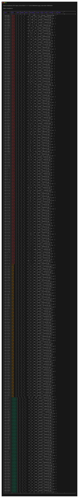
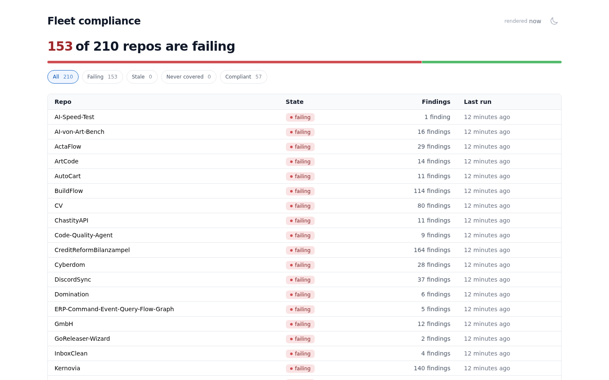

# go-compliance

Fleet compliance evidence for every LarsArtmann project: one state model
(`compliant` / `failing` / `stale` / `never-covered`), one frozen wire
contract, a realtime WebUI, and adapters instead of per-project plumbing.

> **Status: released (v0.2.0, 2026-11-20).** The core module is on the module
> proxy (`go get github.com/larsartmann/go-compliance@v0.2.0`); state model,
> evidence fold, frozen v1 contract, reporter SDK, and the hub service with
> realtime WebUI, SQLite cache, and discovery adapter are all built and
> tested. The hub module is deliberately NOT go-get-able: it ships as the
> `compliance-hub` binary via this repo's flake (no `hub/vX.Y.Z` tags by
> decision). See [FEATURES.md](FEATURES.md) and [STACK.md](STACK.md).





## Install

Consume the core module (reporter SDK, evidence contract, fold) as any Go
dependency:

```bash
go get github.com/larsartmann/go-compliance@v0.2.0
```

One-liner integration in your code (`docs/guides/integrate.md` has the
full walkthrough):

```go
import compliance "github.com/larsartmann/go-compliance"

compliance.Record(ctx, compliance.NewRepoName("my-repo"),
    compliance.RunResult{Verdict: compliance.VerdictPassed})
```

The run lands in the fleet evidence file; the paths (system, user, and the
`GO_COMPLIANCE_EVIDENCE_FILE` override) have their single home in the
[locations table of the integration guide](docs/guides/integrate.md#where-the-evidence-lives).

The `compliance-hub` binary is not `go install`-able (the hub module is
untagged by design); run it from a checkout of this repo:

```bash
nix run .#compliance-hub -- serve --source file --file compliance.json
```

## Architecture

- **Core module** (`github.com/larsartmann/go-compliance`) — domain types,
  state derivation over evidence windows, the frozen v1 contract, a `Source`
  adapter interface, and a one-liner reporter SDK. Two dependencies
  (go-branded-id, go-error-family).
- **Hub module** (`github.com/larsartmann/go-compliance/hub`) — HTTP service
  with a realtime WebUI (Datastar over SSE), the CLI (`compliance
  serve|report|table`), a SQLite evidence cache, and adapters: BuildFlow
  evidence (v1 JSON), project-discovery-daemon (fleet list → never-covered).

Integration goal: BuildFlow-covered projects are compliant by default (zero
changes); everything else reports with one CLI line or one SDK call.

## Embedding the dashboard

Any Go service can mount the realtime fleet dashboard in one call:

```go
hub := events.NewHub()                       // publish snapshots/refreshes here
board := dashboard.New(hub)

mux := http.NewServeMux()
board.RegisterRoutes(mux)                    // / (page), /events (patches), /datastar.js
```

Feed it evidence and everything downstream updates live:

```go
rows := events.RowsFromEvidence(evidence, time.Now(), staleAfter)
published, err := hub.PublishRefresh(rows)   // snapshot first, diffs after
```

`RegisterRoutesAt(dashboard.Routes{...}, mux)` relocates the surface (e.g.
behind `/compliance/`); the page route serves JSON to `Accept:
application/json` clients.

Or run the packaged service: `compliance-hub serve --source file --file
compliance.json` (also `--source buildflow`, `--source cache --db path`).

### Run it

On the fleet host the hub runs as a `systemctl --user` unit, built from the
committed tree and GC-rooted in the nix store:

```bash
scripts/deploy-hub.sh        # build, install, enable, restart; prints the address
```

It binds `192.168.1.150:8477` and reads
`~/.local/state/overview/compliance.json`, which the daily producer timer
(`scripts/deploy-fleet-evidence.sh`) refreshes every morning.

Ad hoc, from a checkout:

```bash
nix run .#compliance-hub -- serve --source file --file compliance.json
```

Or from the devShell (Go toolchain + pinned templ generator):

```bash
nix develop -c bash -c 'cd hub && GOWORK=off go run ./cmd/compliance-hub \
  serve --source file --file compliance.json'
```

Never-covered needs the project-discovery daemon: `--discover-paths`
(default `~/projects`) names the roots it scans, and a discovered project
counts only when it has a `go.mod` (the same rule the producer uses), so
non-Go projects never show as gaps. An empty value disables discovery.

A fleet that has not recorded evidence yet is not a blank page: the
dashboard hides the empty table and explains what will fill it, and the
first producer run replaces the explanation with rows.

### Fleet table

`compliance-hub table` renders the triage view: worst-first by state rank,
then failures. BuildFlow muscle memory carries over:

```bash
compliance-hub table --source cache --db hub.db --sort-by findings
```

`--sort-by` retiebreaks INSIDE the state rank exactly like the producer's
flag (`findings`, `failures` (default), `name`; the producer's `importance`
key is producer-metadata-only). `--format` renders the same columns as
JSON, JSONL, YAML, TOML, CSV, TSV, markdown, HTML, XML, and AsciiDoc.

### Health surface (packaged service)

`serve` exposes the standard probe routes for systemd, Kubernetes, or a
scraping dashboard:

| Route       | Meaning                                                                    |
| ----------- | -------------------------------------------------------------------------- |
| `/healthz`  | Liveness, always passes (an evidence failure must not restart the process) |
| `/readyz`   | 503 until evidence is published; degraded-but-serving stays 200            |
| `/startupz` | Startup latch, passes once the critical `evidence` check first passes      |
| `/version`  | Build version stamp                                                        |

Checks: `evidence` (critical gate), `cache-disk` (128 MiB floor, only with
`--db`), `refresh-freshness` (warn when the loop stalls past 10 minutes),
`discovery` (warn only when the watch stream is down and the last contact
is older than 10 minutes; a connected stream is always healthy), `sse-backpressure` (warn on new patch drops). Shutdown
drains honestly: readiness flips to 503 before the listeners close.

### Exit codes

Failures exit with [go-error-family](https://github.com/LarsArtmann/go-error-family)
BSD sysexits codes, not generic 1 — `systemd` restart policy and shell
muscle memory can rely on them:

| Code | Meaning                                                              |
| ---- | -------------------------------------------------------------------- |
| 0    | Success                                                              |
| 1    | Rejection: invalid flags, bad window, malformed input — do not retry |
| 69   | Infrastructure: internal wiring failure                              |
| 75   | Transient: cache/IO unreachable — retry (e.g. `Restart=on-failure`)  |

Verify live: `compliance-hub report --db /nonexistent/x.db; echo $?` → `75`.

## CI

[`.github/workflows/ci.yml`](.github/workflows/ci.yml) runs per-module
build+test and lint (golangci-lint pinned to the devShell version), dprint,
actionlint, stack-drift-check, docs-gates, `nix flake check`, the art-dupl
clone gate, a templ fmt gate, the report citation gate, a cmdguard usage
gate, the branded-ID gate (BD003 via pinned `linter/v0.5.1`), and the
dashboard CSS freshness gate. Tag pushes (`v*`) re-run the same matrix on
the frozen tag.

The hub module and the flake build need one private dependency
(`github.com/LarsArtmann/go-daemon`). CI reads it via a repository secret:

- **`FLAKE_PAT`** — fine-grained PAT with read-only **Contents** on
  `LarsArtmann/go-daemon`. Without it, the hub/flake jobs skip (not fail);
  an owner must create the secret on each runner host (GitHub **and**
  Forgejo) to activate them.

## Documentation

- [Integrating a project in one line](docs/guides/integrate.md)
- [Library utilization reports](docs/review/libs/index.html) — 22 audited
  dependencies (the full direct dep graph), verdicts and flip triggers
  (citations mechanically verified by `scripts/check-citations.sh`)
- [STACK.md](STACK.md) — foundation decision record (enforced by
  stack-drift-check)
