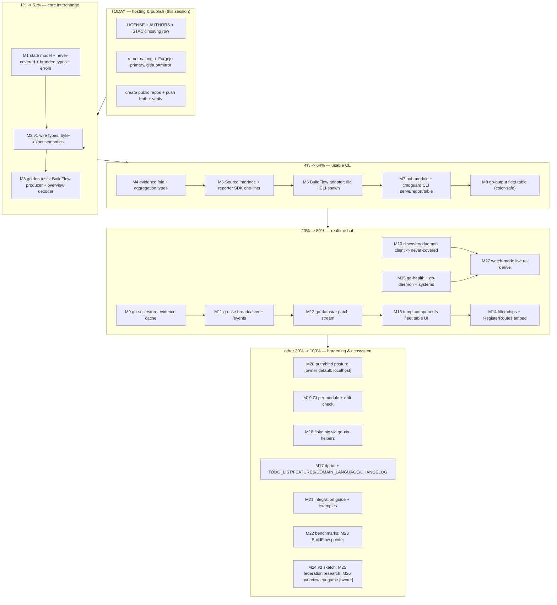

# go-compliance — Pareto Execution Plan (2026-11-17 20:01 CET)

> Format note: the pareto-planning skill defaults to a styled HTML report;
> the owner explicitly requested **an .md file with a mermaid.js execution
> graph** — that instruction wins (recorded here so the next session does not
> "fix" the format). Both Forgejo and GitHub render mermaid natively.

## Context

Born this session (see `docs/status/2026-11-17_19-57_go-compliance-stack-selection-scaffold.md`):
BuildFlow's `compliance` command was evaluated for extraction (verdict: the
generic core ports, the BuildFlow-schema SQL stays), the owner set the product
vision — **superbly easy integration into basically ALL projects + WebUI with
realtime updates** — and the stack was selected and frozen in
[`STACK.md`](../../STACK.md) (17 chosen rows, 8 deliberate exclusions,
drift-check exit 0).

**Owner decisions taken since the status report:**

- **Hosting (answers g3):** Forgejo (`forgejo@evo-x2.home.lan:lars/go-compliance.git`)
  is **primary** (`origin`); GitHub (`git@github.com:LarsArtmann/go-compliance.git`)
  is the **mirror** remote (`github`); **both public**. Fleet convention as
  observed in quotaboard / pim-sync (push to both from local).
- **Still open (owner):** hub auth/bind posture (g1 — default until decided:
  localhost-bind only), overview endgame (g2).

**Inputs ranked (Step 0):** status report §f (46 items) + STACK.md wiring
order (8 steps). No prior plans exist in this repo. Openness verified against
the tree: only `doc.go`, `STACK.md`, `README.md`, LICENSE/AUTHORS,
`docs/status/*` exist — **no product code has shipped**, so nothing in the
backlog is stale. Errata: none.

## Pareto breakdown

### The 1% that delivers 51%

**The core interchange library: state model + frozen v1 wire types + golden
compat tests (both directions).** This is the asset everything else composes
on. With only this, the repo is real: importable, trustworthy, and
byte-compatible with BuildFlow's producer and overview's consumer. Every
adapter, the hub, and the WebUI are downstream of these ~300 lines.

### The 4% that delivers 64%

1% **plus**: evidence fold, `Source` adapter interface, reporter SDK
one-liner, BuildFlow adapter (piped v1 JSON), hub module with cmdguard CLI
and the go-output fleet table. Result: a working `compliance table` CLI that
reproduces the fleet view from BuildFlow evidence — the first usable product
surface, zero UI dependencies, valuable today.

### The 20% that delivers 80%

4% **plus**: the realtime hub — SQLite evidence cache, discovery-daemon
client (never-covered), SSE broadcaster, Datastar patch stream,
templ-components fleet table, filter chips, `RegisterRoutes` embed,
go-health probe, systemd service. Result: the actual vision — the live fleet
dashboard, embeddable in one mux call.

### The other 20% (to reach 100%)

Hardening + ecosystem: auth/bind posture decision and implementation, CI,
flake.nix, dprint + docs set (DOMAIN_LANGUAGE, guides, examples),
benchmarks, v2 API sketch, federation interop research, overview endgame
decision, cross-repo pointer into BuildFlow, meta upkeep, watch-mode.

## Execution graph

## Comprehensive plan — medium granularity (30–100 min each)

Sorted by importance / impact / effort / customer-value. Rank = execution
order. Tier: **1** = 1%→51%, **4** = 4%→64%, **20** = 20%→80%, **100** = the
other 20%.

| Rank | ID  | Task                                                                                                   | Tier  | Impact | Effort | Customer value                                          |
| ---- | --- | ------------------------------------------------------------------------------------------------------ | ----- | ------ | ------ | ------------------------------------------------------- |
| 1    | M16 | Hosting: LICENSE/AUTHORS, remotes (Forgejo primary + GitHub mirror), create public repos, push, verify | today | H      | 30m    | repo exists publicly, primary+mirror per owner decision |
| 2    | M1  | Core port: state model (`compliant/failing/stale/never-covered`), branded types, error policy          | 1     | H      | 90m    | the domain asset; everything composes on it             |
| 3    | M2  | v1 wire types, byte-exact (schema_version, nil-map `{}`/`[]` semantics, deterministic marshal)         | 1     | H      | 60m    | producers/consumers can pin the module                  |
| 4    | M3  | Golden tests: real `buildflow compliance --json` fixture + overview decoder mirror (reject v2)         | 1     | H      | 90m    | trust: byte-compat proven, not claimed                  |
| 5    | M4  | Evidence fold + aggregation types port (source-agnostic, no SQL)                                       | 4     | H      | 60m    | fleet aggregation reusable beyond BuildFlow             |
| 6    | M5  | `Source` adapter interface + reporter SDK one-liner (`compliance.Record`)                              | 4     | H      | 60m    | the "integrate in one line" surface                     |
| 7    | M6  | BuildFlow adapter: piped v1 JSON file + CLI-spawn mode + backoff                                       | 4     | H      | 90m    | 341-repo fleet works day one, zero BuildFlow changes    |
| 8    | M7  | Hub module init + cmdguard CLI (`serve`/`report`/`table`) + flag parity                                | 4     | H      | 90m    | first binary; flags match BuildFlow muscle memory       |
| 9    | M8  | go-output fleet table (severity cells, state labels, worst-first sort)                                 | 4     | M      | 60m    | the triage view operators already know                  |
| 10   | M9  | go-sqlitestore evidence cache + versioned migrations + window queries                                  | 20    | H      | 90m    | hub survives restarts; own evidence history             |
| 11   | M10 | Discovery daemon HTTP client (`/v1/discover`) + never-covered derivation                               | 20    | H      | 90m    | fleet completeness: repos that never ran become visible |
| 12   | M11 | go-sse broadcaster + `/events` endpoint (Last-Event-ID replay)                                         | 20    | H      | 60m    | realtime backbone                                       |
| 13   | M12 | go-datastar patch stream: state diffs → patches/signals + ScriptHandler                                | 20    | H      | 60m    | sub-second UI updates                                   |
| 14   | M13 | templ-components fleet table page (badges, stat cards, detail rows)                                    | 20    | H      | 100m   | the SUPERB dashboard surface                            |
| 15   | M14 | Filter chips, severity grouping, `RegisterRoutes(mux)` embed, content negotiation                      | 20    | M      | 90m    | one-call integration for any service                    |
| 16   | M15 | go-health probe + go-daemon sd_notify + systemd unit                                                   | 20    | M      | 60m    | production service posture                              |
| 17   | M27 | Watch-mode: live re-derive on evidence writes + discovery `/v1/watch`, debounce                        | 20    | M      | 90m    | dashboard is alive without cron                         |
| 18   | M20 | Auth/bind posture: decision doc + localhost default + unix-socket mode                                 | 100   | H      | 60m    | security: fleet data stays local until owner widens     |
| 19   | M19 | CI: build/test/lint per module + drift-check + docs gates (Forgejo+GitHub runners)                     | 100   | H      | 90m    | public repo credibility                                 |
| 20   | M18 | flake.nix via go-nix-helpers (devShell, packages, both modules)                                        | 100   | M      | 90m    | fleet-standard build                                    |
| 21   | M17 | Repo hygiene: dprint + TODO_LIST/FEATURES/DOMAIN_LANGUAGE/CHANGELOG                                    | 100   | M      | 60m    | docs-health ritual target exists                        |
| 22   | M21 | Integration guide ("one line per project") + `examples/reporter`                                       | 100   | M      | 60m    | the superbly-easy promise, documented                   |
| 23   | M22 | Benchmarks: fold + derive over 300+ repos, record baseline                                             | 100   | L      | 30m    | perf evidence for the 341-repo fleet                    |
| 24   | M23 | Cross-repo: BuildFlow TODO_LIST pointer to this repo + verdict link                                    | 100   | M      | 30m    | no future re-derivation of the extraction verdict       |
| 25   | M24 | v2 API design sketch (compat policy: v1 emittable forever)                                             | 100   | L      | 60m    | evolution path without breaking overview                |
| 26   | M25 | Federation interop research (hub ↔ go-health-dashboard)                                                | 100   | L      | 60m    | future convergence, informed                            |
| 27   | M26 | Overview endgame decision + migration note [owner-dependent]                                           | 100   | M      | 30m    | prevents double-dashboard drift                         |

## Detailed breakdown — fine granularity (≤12 min each)

All tasks, sorted by tier → parent rank → execution order. `Min` = estimated
minutes. Full table also machine-harvestable into TODO_LIST.md.

| ID   | Task (≤12 min)                                                   | Parent | Tier  | Min |
| ---- | ---------------------------------------------------------------- | ------ | ----- | --- |
| F001 | `go get` go-branded-id + go-error-family into core go.mod        | M1     | 1     | 5   |
| F002 | state.go: State type + 4 state constants                         | M1     | 1     | 10  |
| F003 | Port DeriveComplianceState (staleAfter<=0 disables arm)          | M1     | 1     | 10  |
| F004 | Add never-covered derivation (absent from evidence union)        | M1     | 1     | 12  |
| F005 | Branded types: RepoName, SourceName via go-branded-id            | M1     | 1     | 10  |
| F006 | Error sentinels + go-error-family wraps for core paths           | M1     | 1     | 12  |
| F007 | Table-driven tests: state derivation incl. edge cases            | M1     | 1     | 12  |
| F008 | ginkgo/gomega suite bootstrap for core                           | M1     | 1     | 12  |
| F009 | Port report/repo/step wire structs with json tags                | M2     | 1     | 10  |
| F010 | Port buildComplianceReport shaping (nil-map → `{}` / `[]`)       | M2     | 1     | 12  |
| F011 | Deterministic marshal (json/v2 options) + helper                 | M2     | 1     | 10  |
| F012 | Round-trip test JSON→struct→JSON                                 | M2     | 1     | 12  |
| F013 | Capture real `buildflow compliance --json` fixture into testdata | M3     | 1     | 10  |
| F014 | Golden: marshal == fixture (stable byte subset)                  | M3     | 1     | 12  |
| F015 | Golden: overview decoder accepts output (schema_version==1)      | M3     | 1     | 10  |
| F016 | Negative golden: schema_version 2 rejected like overview         | M3     | 1     | 10  |
| F017 | Fixture refresh script + doc note                                | M3     | 1     | 10  |
| F018 | Port evidence + step-evidence structs                            | M4     | 4     | 10  |
| F019 | Port evidence fold (ensure/union, worstStepLimit) — no SQL       | M4     | 4     | 12  |
| F020 | Tests: repos never dropped for being quiet                       | M4     | 4     | 12  |
| F021 | Tests: worstStepLimit cap + deterministic order                  | M4     | 4     | 8   |
| F022 | Define Source interface (ctx, window, stepFilter)                | M5     | 4     | 12  |
| F023 | Define Evidence writer port for reporters                        | M5     | 4     | 10  |
| F024 | Reporter SDK Record() one-liner (memory + file impl)             | M5     | 4     | 12  |
| F025 | Godoc example for Record                                         | M5     | 4     | 10  |
| F026 | FileSource: read piped compliance.json                           | M6     | 4     | 12  |
| F027 | Wire → evidence normalization                                    | M6     | 4     | 10  |
| F028 | CLI-spawn mode (run `buildflow compliance --json`)               | M6     | 4     | 12  |
| F029 | Adapter tests with fixtures                                      | M6     | 4     | 12  |
| F030 | Missing-file backoff/TTL (overview precedent)                    | M6     | 4     | 10  |
| F031 | `go mod init` hub module + go.work entry                         | M7     | 4     | 8   |
| F032 | cmdguard scaffold: root + serve/report/table                     | M7     | 4     | 12  |
| F033 | Flags: --since --stale-after --worst-steps --json parity         | M7     | 4     | 12  |
| F034 | Port parseSinceDuration/parseStaleAfter                          | M7     | 4     | 10  |
| F035 | CLI smoke test (cmdguard test pattern)                           | M7     | 4     | 12  |
| F036 | Fleet table via go-output/table                                  | M8     | 4     | 12  |
| F037 | Severity cells ERR/WARN/INFO + state labels/colors               | M8     | 4     | 12  |
| F038 | Worst-first sort + cell truncation                               | M8     | 4     | 10  |
| F039 | Alignment-under-color regression test (gotcha #298)              | M8     | 4     | 12  |
| F040 | Cache schema: evidence_runs/findings/versions                    | M9     | 20    | 12  |
| F041 | go-sqlitestore Open + membership migration                       | M9     | 20    | 12  |
| F042 | Evidence upsert write path                                       | M9     | 20    | 12  |
| F043 | Window query over own cache                                      | M9     | 20    | 12  |
| F044 | Store integration tests (real SQLite)                            | M9     | 20    | 12  |
| F045 | HTTP client over unix socket (/v1/discover)                      | M10    | 20    | 12  |
| F046 | Repo-name normalization → evidence repos                         | M10    | 20    | 12  |
| F047 | never-covered set difference + state assignment                  | M10    | 20    | 10  |
| F048 | /v1/watch SSE subscribe → refresh trigger                        | M10    | 20    | 12  |
| F049 | Tests via httptest over unix socket                              | M10    | 20    | 12  |
| F050 | Broadcaster wiring + heartbeat                                   | M11    | 20    | 10  |
| F051 | Evidence refresh → state-diff events                             | M11    | 20    | 12  |
| F052 | /events endpoint with Last-Event-ID replay                       | M11    | 20    | 12  |
| F053 | ssetest-based endpoint tests                                     | M11    | 20    | 12  |
| F054 | Patch types for fleet table rows                                 | M12    | 20    | 12  |
| F055 | Signal patches for counts/badges                                 | M12    | 20    | 12  |
| F056 | ScriptHandler serving DataStar JS                                | M12    | 20    | 8   |
| F057 | datastartest E2E assertions                                      | M12    | 20    | 12  |
| F058 | templ setup + layout via templ-components                        | M13    | 20    | 12  |
| F059 | Fleet table component (repo/state/severity columns)              | M13    | 20    | 12  |
| F060 | Badges + stat cards                                              | M13    | 20    | 12  |
| F061 | Detail row expansion (worst steps)                               | M13    | 20    | 12  |
| F062 | Page render test (templ harness)                                 | M13    | 20    | 12  |
| F063 | Filter chips (state filter)                                      | M14    | 20    | 12  |
| F064 | Grouping by severity/state                                       | M14    | 20    | 12  |
| F065 | RegisterRoutes(mux) public surface                               | M14    | 20    | 10  |
| F066 | Content negotiation HTML/JSON                                    | M14    | 20    | 12  |
| F067 | Embedding quickstart in README                                   | M14    | 20    | 10  |
| F068 | go-health probe registration                                     | M15    | 20    | 10  |
| F069 | sd_notify wiring via go-daemon                                   | M15    | 20    | 12  |
| F070 | systemd unit file + docs                                         | M15    | 20    | 12  |
| F071 | Smoke: serve + curl /health                                      | M15    | 20    | 10  |
| F072 | LICENSE + AUTHORS (MIT, fleet format)                            | M16    | today | 8   |
| F073 | STACK.md hosting row + decision-log entry                        | M16    | today | 8   |
| F074 | git remote add origin (Forgejo) + github (mirror)                | M16    | today | 6   |
| F075 | Create public repos (Forgejo + GitHub)                           | M16    | today | 8   |
| F076 | Push both remotes + `git ls-remote` verify                       | M16    | today | 8   |
| F077 | dprint.json + format check                                       | M17    | 100   | 10  |
| F078 | TODO_LIST.md seeded from this plan                               | M17    | 100   | 12  |
| F079 | FEATURES.md initial inventory                                    | M17    | 100   | 10  |
| F080 | DOMAIN_LANGUAGE.md core terms                                    | M17    | 100   | 12  |
| F081 | CHANGELOG.md Unreleased section                                  | M17    | 100   | 8   |
| F082 | flake.nix skeleton via go-nix-helpers                            | M18    | 100   | 12  |
| F083 | devShell + packages for both modules                             | M18    | 100   | 12  |
| F084 | vendorHash bootstrap loop                                        | M18    | 100   | 12  |
| F085 | `nix flake check` green                                          | M18    | 100   | 12  |
| F086 | CI: build+test per module                                        | M19    | 100   | 12  |
| F087 | CI: lint job (golangci pinned to devShell version)               | M19    | 100   | 12  |
| F088 | CI: drift-check + docs-gates jobs                                | M19    | 100   | 12  |
| F089 | CI: workflow files valid on Forgejo + GitHub runners             | M19    | 100   | 12  |
| F090 | Decision doc: bind posture (default localhost)                   | M20    | 100   | 10  |
| F091 | Bind flag + localhost default                                    | M20    | 100   | 10  |
| F092 | Optional unix-socket listen mode                                 | M20    | 100   | 12  |
| F093 | Test: non-localhost bind requires explicit flag                  | M20    | 100   | 10  |
| F094 | examples/reporter/main.go                                        | M21    | 100   | 12  |
| F095 | Guide: integrate a project in one line                           | M21    | 100   | 12  |
| F096 | README screenshots (terminal + WebUI)                            | M21    | 100   | 12  |
| F097 | Benchmark fold+derive at 300 repos                               | M22    | 100   | 10  |
| F098 | Record baseline under benchmarks/                                | M22    | 100   | 8   |
| F099 | BuildFlow TODO_LIST pointer row + link                           | M23    | 100   | 8   |
| F100 | STACK.md errata check (hosting done)                             | M23    | 100   | 6   |
| F101 | v2 API design doc (diff vs v1)                                   | M24    | 100   | 12  |
| F102 | Compat policy: v1 emittable forever                              | M24    | 100   | 10  |
| F103 | Research go-health-dashboard federation API                      | M25    | 100   | 12  |
| F104 | Interop options note in docs                                     | M25    | 100   | 10  |
| F105 | Endgame decision note (after owner answers g2)                   | M26    | 100   | 8   |
| F106 | Migration sketch if hub replaces overview views                  | M26    | 100   | 10  |
| F107 | Re-derive on store writes (hook)                                 | M27    | 20    | 12  |
| F108 | Debounce + coalesce events                                       | M27    | 20    | 12  |
| F109 | E2E: evidence change → browser event                             | M27    | 20    | 12  |

**Counts:** 109 fine tasks · Tier 1: 17 · Tier 4: 22 · Tier 20: 35 · Tier
100: 30 · today: 5 · Σ ≈ 21 h. Medium: 27 tasks · Σ ≈ 30.5 h.

## Execution rules

1. Verify after every task (build + tests green before moving on).
2. No verschlimmbessern: every change leaves the repo verifiably no worse.
3. The plan is a snapshot — harvest into `TODO_LIST.md` (M17/F078) and keep
   THAT current; annotate, never rewrite, this file.
4. Owner-decision gates: M20 (bind posture) and M26 (overview endgame) block
   on g1/g2 answers; defaults documented so work proceeds safely meanwhile.
5. Stack is frozen by STACK.md; any new `larsartmann/*` require gets a row +
   drift-check re-run.

## Errata

None — first plan in this repo; backlog was verified against the tree (no
product code exists yet).
