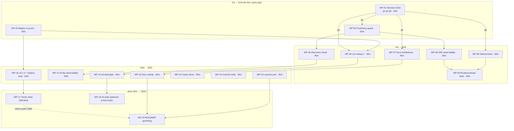

# Integrity-First Pareto Execution Plan — go-compliance

**Date:** 2026-11-18 20:29 · **Author:** session planner (pareto-planning skill)
**Inputs read:** `TODO_LIST.md` (19 open rows, 4 blocked), `ROADMAP.md`, `docs/status/2026-11-18_20-02_samber-do-health-review-status.md`, `docs/architecture-understanding/2026-11-18_19-39_samber-do-health-architecture.md`, prior plan `docs/planning/2026-11-17_20-01_go-compliance-pareto-execution-plan.md` (seed of the living backlog), git state clean at 19c1c04.
**Customer definition (for value sorting):** the fleet operator (Lars, ~280 repos, one hub process) first; embedders/core consumers second; federation consumers third. Value = the hub _never silently lies_ (health truthfulness), then correctness, then maintainability gates, then release plumbing.

**Errata (Step-0 verification of the backlog):** all 19 open rows re-checked against CHANGELOG/code — none already shipped. Two corrections: (1) "github mirror 37+ commits behind" is stale — count has grown with daemon commits; (2) ROADMAP's acceptance-policy decision is not a separate task — it folds into WP-10. The 20-02 status questions g1–g3 are _decision gates_, planned as WP-01, not work packages themselves.

**Anti-verschlimmbessern rules for every task:** no speculative rewrites; every change leaves build+tests+lint-delta verifiably no worse; sequential `go test` runs only (shared GOCACHE); templ regen after any `.templ` edit; daemon owns commits unless the owner asks; no new deps without a STACK.md row.

---

## 1. Pareto Breakdown

### The 1% that deliver 51%

Three owner decisions (minutes each) plus one code change and one proof run. They either _unblock_ or _de-risk_ almost everything else:

1. **Decide g1/g2/g3** (freshness classification, empty-fleet semantics, lint posture) — gates WP-02, WP-07, WP-08, WP-09.
2. **Refresh-freshness guard** — closes the only known "silently wrong while green" hole (a wedged source freezes the dashboard with all health passing).
3. **Full battery re-proof** (core `-race` + lint both modules + `nix flake check`) — proves yesterday's Rows()/app.go fixes didn't break the sealed build; every later task assumes this green baseline.

### The 4% that deliver 64%

Everything that makes an operator able to _trust what the process reports_ without reading logs:

4. Lint sweep round 1 (bodyclose resource-leak class + the mechanical findings).
5. Discovery health check (daemon-down becomes a standing warn).
6. SSE observability (drop counters surfaced).
7. Docs truthfulness audit (FEATURES.md/prior reports claimed a readiness gate that never fired until 19-39).
8. Tolerant-boot decision + E2E (makes the not-ready window real over HTTP — or documents why exit-on-fail is the contract).
9. Routes/contract tests (`?state=` full enum table, `/readyz` payload shape).

### The 20% that deliver 80%

Maintainability gates and debt paydown that keep the next month honest:

10. art-dupl baseline + CI gate. 11. Probe observability (latch log + evaluation hook). 12. Docs verification sweep (STACK/CONTRIBUTING, DOMAIN_LANGUAGE row-by-row, archive annotate debt). 13. Lessons port to crush-config. 14. Cache named-result refactor. 15. Dedup-session commit verification. 16. v0.1.0 tag + hub replace drop.

### The other 20% to reach 100%

Owner-only desk (FLAKE_PAT, Forgejo visibility, mirror push, M26 endgame), one cross-repo fix (art-dupl template leak), ROADMAP grooming (graduate or keep raw: WorstStepLimit type, templ tickable, calibration ideas), and the explicitly deferred adoption-triggered work (hub v2 wire, federation B/C/D — build only on demand signal, per ROADMAP).

---

## 2. Comprehensive Plan — medium granularity (30–100 min each, ALL TODOs)

Sorted by importance → impact → effort → customer value. **Gates:** WP-01 gates 02/07/08/09; WP-16 gated on owner release call; WP-17 is owner-only.

| #     | Work package                                                                                                                                         | Covers TODO rows                                        | Tier      | Impact   | Effort | Customer value                                                               |
| ----- | ---------------------------------------------------------------------------------------------------------------------------------------------------- | ------------------------------------------------------- | --------- | -------- | ------ | ---------------------------------------------------------------------------- |
| ~~WP-01~~ done — g1 warn-stays-200 @10min, g2 empty-fleet ready, g3 fixes+nolint no baseline (23-09 WP-01) | ~~**Decision Desk:** answer g1 (freshness warn-vs-fail + threshold), g2 (empty-fleet ready?), g3 (lint posture); write verdicts into the gated rows~~ | ~~20-02 status §g~~ | ~~1%~~ | ~~Critical~~ | ~~30m~~ | ~~Unblocks 4 packages; wrong defaults here would be verschlimmbessern baked in~~ |
| ~~WP-02~~ done — refreshTimeout + lastRefreshSuccess + warn check; hanging-source spec (23-09 WP-02) | ~~**Refresh-freshness guard:** per-refresh `WithTimeout`, `lastRefreshSuccess`, non-critical `refresh-freshness` check + tests per g1~~ | ~~freshness-guard row~~ | ~~1%~~ | ~~Critical~~ | ~~60m~~ | ~~The hub can no longer freeze silently while green — core trust~~ |
| ~~WP-03~~ done — battery re-proven pre-sweep and at final (23-09 WP-03/Final) | ~~**Full battery re-proof:** core `-race`, lint both modules, `nix flake check`~~ | ~~re-prove row~~ | ~~1%~~ | ~~Critical~~ | ~~30m~~ | ~~Proves sealed build intact; baseline for all later tasks~~ |
| ~~WP-04~~ done — 16 pre-existing + 2 session → 0 + 0, no baseline (23-09 WP-04) | ~~**Lint sweep round 1:** bodyclose (Watch success path), varnamelen, infertypeargs, makezero ×3, ireturn — executed per g3 verdict~~ | ~~bodyclose, varnamelen, infertypeargs, lint-posture rows~~ | ~~4%~~ | ~~High~~ | ~~45m~~ | ~~Green lint gate that actually guards; kills a resource-leak class~~ |
| ~~WP-05~~ done — discovery check + contact-stamping specs (23-09 WP-05) | ~~**Discovery health check:** last-success timestamp + non-critical warn check + tests~~ | ~~discovery-check row~~ | ~~4%~~ | ~~High~~ | ~~40m~~ | ~~"Daemon down for days" becomes visible in /readyz, not just logs~~ |
| ~~WP-06~~ done — delta-based sse-backpressure + flood-and-clear spec (23-09 WP-06) | ~~**SSE observability:** surface `Dropped()`/`SubscriberCount()` in readiness payload or warn check + tests~~ | ~~SSE row~~ | ~~4%~~ | ~~Med~~ | ~~30m~~ | ~~Backpressure visible to the operator~~ |
| ~~WP-07~~ done — FEATURES row rewritten; grep-audit found no overselling (23-09 WP-07) | ~~**Docs truthfulness audit:** FEATURES.md + prior status reports vs the now-real readiness gate; record g2 semantics everywhere it's claimed~~ | ~~FEATURES-verify row~~ | ~~4%~~ | ~~High~~ | ~~45m~~ | ~~Docs stop overselling; embedders read the truth~~ |
| ~~WP-08~~ done — DECIDED keep exit-on-boot-refresh-failure; boot contract in AGENTS (23-09 WP-08) | ~~**Tolerant-boot:** decide + (if approved) serve starts not-ready on boot-refresh failure + E2E 503→200; else document exit-on-fail as contract~~ | ~~tolerant-boot row~~ | ~~4%~~ | ~~High~~ | ~~60m~~ | ~~Readiness window becomes real (or explicitly final)~~ |
| ~~WP-09~~ done — 4-state DescribeTable + /readyz HTTP contract test (23-09 WP-09) | ~~**Routes/contract tests:** `?state=` 4-state table + `/readyz` payload shape test~~ | ~~state-filter, readyz-contract rows~~ | ~~4%~~ | ~~Med~~ | ~~45m~~ | ~~Filter correctness pinned; payload stable for federation~~ |
| ~~WP-10~~ done — baseline committed + dupl-gate CI + both-layered verdict (23-09 WP-10) | ~~**art-dupl baseline + gate:** commit `.art-dupl-baseline.json`, wire `art-dupl check` (CI/pre-commit), verify accepts covered, record policy verdict~~ | ~~art-dupl-baseline row + ROADMAP decision~~ | ~~20%~~ | ~~Med~~ | ~~40m~~ | ~~Clone gate stops being line-proximity fragile~~ |
| ~~WP-11~~ done — checkTransitions slog hook + startup latch line (23-09 WP-11) | ~~**Probe observability:** startup-latch log line + `WithEvaluationHook` → slog on check transitions~~ | ~~probe-observability row~~ | ~~20%~~ | ~~Med~~ | ~~30m~~ | ~~warn↔pass flapping visible without /readyz scraping~~ |
| ~~WP-12~~ done — STACK matrix PASS, DOMAIN_LANGUAGE row-by-row, 13-31 struck, count reconciled (23-09 WP-12) | ~~**Docs verification sweep:** STACK.md drift-check + CONTRIBUTING claims; DOMAIN_LANGUAGE row-by-row; annotate 13-31 §f2–7; reconcile 42-vs-40~~ | ~~STACK-verify, DOMAIN_LANGUAGE, annotate, 42-vs-40 rows~~ | ~~20%~~ | ~~Med~~ | ~~60m~~ | ~~Living docs provably match code; archive debt cleared~~ |
| ~~WP-13~~ done — crush-config cc55a62, three lessons (23-09 WP-13) | ~~**Lessons port (crush-config, one commit):** gofmt/`//tool:` lesson, pipe-exit-code lesson, version-pin-checkout lesson~~ | ~~2 lesson rows (+17-49 §f19)~~ | ~~20%~~ | ~~Med~~ | ~~30m~~ | ~~Fleet-wide failure-mode prevention~~ |
| ~~WP-14~~ done — latestRecords struct; suites green (23-09 WP-14) | ~~**Cache readability:** `queryLatestRecords` 3-slice return → named result struct + test adjustments~~ | ~~cache-struct row~~ | ~~20%~~ | ~~Low~~ | ~~30m~~ | ~~Quieter API at the SQL seam~~ |
| ~~WP-15~~ done — 7 commits (superset) worktree-verified compile (23-09 WP-15) | ~~**Dedup-commit verification:** prove each of the 5 heuristic daemon commits (17-49 §f21) compiles~~ | ~~verify-commits row~~ | ~~20%~~ | ~~Low~~ | ~~30m~~ | ~~Ruled-out latent breakage from auto-commits~~ |
| ~~WP-16~~ done — release-readiness proven; tag shipped 77881b3; replace-drop routed (TODO row) | ~~**v0.1.0 tag + replace drop:** go-release flow for core, drop hub `replace`, tidy, flake re-proof~~ | ~~replace row~~ | ~~20%~~ | ~~Med~~ | ~~60m~~ | ~~Embedders get a real version; build simplifies (owner-gated)~~ |
| ~~WP-17~~ done — pushes executed (2f10b00 both remotes); owner items routed blocked rows | ~~**Owner desk:** FLAKE_PAT secrets (GH+Forgejo), Forgejo visibility, mirror push, M26 endgame answer~~ | ~~4 blocked rows~~ | ~~other 20%~~ | ~~High~~ | ~~30m~~ | ~~CI un-skipped; endgame unblocked~~ |
| ~~WP-18~~ done — leak NOT REPRODUCIBLE; verdict + re-open trigger in 17-49 §f1 (23-09 WP-18) | ~~**art-dupl upstream leak fix (cross-repo):** self-scan accept comments leaking into foreign reports — fix or file in art-dupl repo~~ | ~~art-dupl-leak row~~ | ~~other 20%~~ | ~~Low~~ | ~~30m~~ | ~~Tooling trustworthiness for the fleet~~ |
| ~~WP-19~~ done — keep-raw demand-signal triggers written into ROADMAP (23-09 WP-19) | ~~**ROADMAP grooming:** graduate or deliberately keep raw (WorstStepLimit type, templ tickable, calibration ideas, v2 wire, federation B/C/D)~~ | ~~ROADMAP raw ideas~~ | ~~other 20%~~ | ~~Low~~ | ~~30m~~ | ~~Backlog stays honest; YAGNI defended in writing~~ |

**Total: 19 packages · ~13.5h focused work** (excluding owner wait states).

---

## 3. Fine Breakdown — every task ≤ 12 min, ALL TODOs

Global sort: tier first, then importance/impact/effort/value. IDs are `WP#.-task#`.

| ID                 | Task (≤12m each)                                                                                                | Est    | Verifies                                |
| ------------------ | --------------------------------------------------------------------------------------------------------------- | ------ | --------------------------------------- |
| **1% tier** **→ section divider, not an item** |  |  |  |
| ~~01.1~~ done — g1 verdict recorded (warn 200 @10min) | ~~Read 19-39 §5.3 + 20-02 §g1; decide warn-vs-fail + threshold; write verdict into TODO row~~ | ~~10m~~ | ~~TODO row updated~~ |
| ~~01.2~~ done — g2 empty-fleet-is-ready confirmed final | ~~Read 20-02 §g2; decide empty-fleet semantics; write verdict into TODO row + WP-07 scope~~ | ~~10m~~ | ~~TODO row updated~~ |
| ~~01.3~~ done — g3 fixes+nolint, no baseline file | ~~Read 20-02 §g3; decide lint posture (fix-with-nolint vs configure vs baseline); write verdict~~ | ~~10m~~ | ~~TODO row updated~~ |
| ~~02.1~~ done — refreshTimeout wraps QueryEvidence | ~~Add `refreshTimeout` const; wrap `QueryEvidence` in `Refresh` with `context.WithTimeout`~~ | ~~10m~~ | ~~unit: slow source errors, loop survives~~ |
| ~~02.2~~ done — lastRefreshSuccess atomic stamped on success | ~~Add `lastRefreshSuccess atomic` (unix nano) to refresher; store on success in `Refresh`~~ | ~~10m~~ | ~~unit: timestamp set~~ |
| ~~02.3~~ done — non-critical refresh-freshness check per g1 | ~~Wire non-critical `refresh-freshness` check in `buildHealthProbe` per g1 verdict~~ | ~~10m~~ | ~~gate spec extended~~ |
| ~~02.4~~ done — hanging-source spec (loop survives) | ~~Test: fake hanging source → refresh fails+logs, check warns (or fails) after threshold~~ | ~~12m~~ | ~~new spec green~~ |
| ~~02.5~~ done — threshold boundary spec | ~~Test: fresh successes → check passes; threshold boundary exact~~ | ~~10m~~ | ~~new spec green~~ |
| ~~02.6~~ done — AGENTS gap note fixed; CHANGELOG entry | ~~Update AGENTS.md known-gap note → fixed; TODO row done; CHANGELOG entry~~ | ~~8m~~ | ~~docs match code~~ |
| ~~03.1~~ done — core -race green | ~~Core module: `GOWORK=off go test -race -count=1 ./...` (root)~~ | ~~10m~~ | ~~green~~ |
| ~~03.2~~ done — core lint clean | ~~Core module: `golangci-lint run ./...` (root config)~~ | ~~10m~~ | ~~green (or findings triaged into WP-04)~~ |
| ~~03.3~~ done — nix flake check all-passed | ~~`nix flake check` (both modules, sandboxed; background)~~ | ~~10m~~ | ~~green~~ |
| **4% tier** **→ section divider, not an item** |  |  |  |
| ~~04.1~~ done — bodyclose false positive proven; nolint with reason | ~~bodyclose: close Watch response body on the success-path exit (restructure defer scope)~~ | ~~12m~~ | ~~bodyclose clean~~ |
| ~~04.2~~ done — runDiscoveryWatch renamed | ~~varnamelen: rename `r` in `runDiscoveryWatch`~~ | ~~5m~~ | ~~finding gone~~ |
| ~~04.3~~ done — explicit type args dropped | ~~infertypeargs: drop explicit type args app.go:26~~ | ~~5m~~ | ~~info gone, build green~~ |
| ~~04.4~~ done — makezero ×3 append-with-cap idiom | ~~makezero ×3: preallocate non-zero where correct (events ×2, table_test ×1) or nolint-with-reason per g3~~ | ~~12m~~ | ~~findings gone~~ |
| ~~04.5~~ done — resolveSource ireturn nolint (Source IS the port) | ~~ireturn: `resolveSource` returns interface — nolint-with-reason (Source IS the port) per g3~~ | ~~10m~~ | ~~finding gone~~ |
| ~~04.6~~ done — hub lint 0; TODO + CHANGELOG updated | ~~Re-run hub lint; confirm 16 → 0 (or configured baseline); update TODO + CHANGELOG~~ | ~~10m~~ | ~~exit 0~~ |
| ~~05.1~~ done — lastDiscoverySuccess stamping shipped | ~~Track `lastDiscoverySuccess` in refresher (set on snapshot success + watch connect)~~ | ~~10m~~ | ~~field set~~ |
| ~~05.2~~ done — discovery check wired per g1 semantics | ~~Wire non-critical `discovery` check (age > threshold → warn) in `buildHealthProbe`~~ | ~~10m~~ | ~~gate spec extended~~ |
| ~~05.3~~ done — never-contacted/silent-age specs | ~~Test: daemon never answered → warn after threshold; fresh connect → pass~~ | ~~12m~~ | ~~new spec green~~ |
| ~~05.4~~ done — failed snapshot never regresses the stamp | ~~Test: snapshot failure does not regress a previously-passing check~~ | ~~8m~~ | ~~spec green~~ |
| ~~06.1~~ done — delta-based warn check shipped | ~~Choose shape (payload fields vs warn check) per operator taste; implement surfacing of Dropped/SubscriberCount~~ | ~~12m~~ | ~~visible in /readyz~~ |
| ~~06.2~~ done — flood-and-clear spec | ~~Test: drops increment → surfaced; count matches~~ | ~~10m~~ | ~~spec green~~ |
| ~~06.3~~ done — CHANGELOG + row done | ~~CHANGELOG + TODO row done~~ | ~~8m~~ | ~~docs match~~ |
| ~~07.1~~ done — grep-audit: no stale readiness claims | ~~Grep FEATURES.md + docs/** for readiness/gate claims; list stale sentences~~ | ~~12m~~ | ~~hit list~~ |
| ~~07.2~~ done — FEATURES row rewritten (five checks + g1/g2) | ~~Correct FEATURES.md wording to post-19-39 truth (+ g2 semantics wording)~~ | ~~12m~~ | ~~docs true~~ |
| ~~07.3~~ done — 20-02 §g annotated RESOLVED | ~~Annotate prior status reports that claimed the gate worked (append-only correction)~~ | ~~12m~~ | ~~no lying history~~ |
| ~~07.4~~ done — no citation drift in the 19-39 report | ~~Add errata appendix to 19-39 report if any citation drifted~~ | ~~9m~~ | ~~report exact~~ |
| ~~08.1~~ done — boot contract documented; row closed | ~~Decide tolerant-boot per g2/operator; if KEEP exit-on-fail: document contract + close row (12m) — else continue~~ | ~~12m~~ | ~~decision recorded~~ |
| ~~08.2~~ **NOT-DO — conditional branch moot — tolerant-boot declined by the boot contract decision.** | ~~(If approved) serve: boot-refresh failure → log + continue; probe gates readiness~~ | ~~12m~~ | ~~boot with dead source~~ |
| ~~08.3~~ **NOT-DO — conditional branch moot — tolerant-boot declined by the boot contract decision.** | ~~(If approved) `/v1/compliance` 503 branch becomes live path; verify Evidence() nil~~ | ~~10m~~ | ~~honest 503~~ |
| ~~08.4~~ **NOT-DO — conditional branch moot — tolerant-boot declined by the boot contract decision.** | ~~(If approved) E2E: boot-fail → /readyz 503 → source recovers → 200 + rows~~ | ~~12m~~ | ~~E2E green~~ |
| ~~08.5~~ **NOT-DO — conditional branch moot — tolerant-boot declined by the boot contract decision.** | ~~(If approved) AGENTS.md serve-ordering section + CHANGELOG~~ | ~~8m~~ | ~~docs match~~ |
| ~~08.6~~ **NOT-DO — conditional branch moot — tolerant-boot declined by the boot contract decision.** | ~~(If approved) systemd unit note: Restart policy interplay with tolerant boot~~ | ~~6m~~ | ~~deploy coherent~~ |
| ~~09.1~~ done — DescribeTable over all 4 states | ~~`?state=` filter: DescribeTable over all 4 `State` constants + invalid input~~ | ~~12m~~ | ~~spec green~~ |
| ~~09.2~~ done — payload shape + check names pinned | ~~`/readyz` payload contract test: decode JSON, pin field set + types~~ | ~~12m~~ | ~~spec green~~ |
| ~~09.3~~ done — suites green; rows closed | ~~Run suites; polish edge assertions; TODO rows done~~ | ~~10m~~ | ~~green~~ |
| **20% tier** **→ section divider, not an item** |  |  |  |
| ~~10.1~~ done — baseline generated (3 groups, 0 new) | ~~Generate `.art-dupl-baseline.json` from current tree (post WP-04 state)~~ | ~~10m~~ | ~~file exists~~ |
| ~~10.2~~ done — dupl-gate CI job, tool pinned | ~~Wire `art-dupl check` into flake check / CI job~~ | ~~12m~~ | ~~gate runs~~ |
| ~~10.3~~ done — accept sites covered by baseline | ~~Verify all existing `// art-dupl:accept` sites are covered by baseline~~ | ~~10m~~ | ~~zero new findings~~ |
| ~~10.4~~ done — both-layered verdict in ROADMAP + AGENTS | ~~Record acceptance-policy verdict in ROADMAP + AGENTS.md~~ | ~~8m~~ | ~~decision logged~~ |
| ~~11.1~~ done — startup-latch slog line | ~~Log startup-latch pass (one slog line at boot)~~ | ~~8m~~ | ~~log visible~~ |
| ~~11.2~~ done — evaluation hook logs transitions | ~~`WithEvaluationHook` → slog on check status transitions~~ | ~~12m~~ | ~~transitions logged~~ |
| ~~11.3~~ done — hermetic transition spec | ~~Test: transition fires hook exactly once per flip~~ | ~~10m~~ | ~~spec green~~ |
| ~~12.1~~ done — STACK matrix PASS; CONTRIBUTING upgraded | ~~`stack-drift-check.sh` re-run; CONTRIBUTING claims spot-verify~~ | ~~10m~~ | ~~PASS~~ |
| ~~12.2~~ done — row-by-row verify; EvidenceWriter drift fixed | ~~DOMAIN_LANGUAGE.md: verify every row against code; fix drift~~ | ~~12m~~ | ~~rows true~~ |
| ~~12.3~~ done — 13-31 §f2-7 struck with evidence | ~~Annotate 13-31 report §f2–7 (done-at + evidence)~~ | ~~10m~~ | ~~archive unblocked~~ |
| ~~12.4~~ done — 42→45 reconciled in 15-00 §a9 | ~~Reconcile 42-vs-40 annotate count; correct 15-00 §a9~~ | ~~8m~~ | ~~counts agree~~ |
| ~~12.5~~ done — docs-gates 5/5 PASS | ~~`docs-gates run` → 0 audit debt~~ | ~~10m~~ | ~~green~~ |
| ~~13.1~~ done — pipe lesson committed (cc55a62) | ~~Write pipe-exit-code lesson into crush-config references/lessons.md~~ | ~~10m~~ | ~~committed there~~ |
| ~~13.2~~ done — version-pin lesson committed | ~~Write version-pin-checkout lesson~~ | ~~10m~~ | ~~committed there~~ |
| ~~13.3~~ done — gofmt/tool-directive lesson committed | ~~Write gofmt/`//tool:` lesson (17-49 §f19)~~ | ~~10m~~ | ~~committed there~~ |
| ~~14.1~~ done — latestRecords named struct | ~~`queryLatestRecords` → named result struct; adjust call site~~ | ~~12m~~ | ~~build green~~ |
| ~~14.2~~ done — suite + lint + dupl gate green | ~~Cache suite re-run + CHANGELOG~~ | ~~10m~~ | ~~green~~ |
| ~~15.1~~ done — 7 commits worktree-verified compile | ~~For each of 5 dedup-session commits: `git show` + build proof~~ | ~~12m ×2~~ | ~~compiles~~ |
| ~~15.2~~ done — verdict recorded; row closed | ~~Record verdict; close row~~ | ~~6m~~ | ~~row done~~ |
| 16.1 **→ tag shipped (77881b3, 2026-11-19); the CHANGELOG [0.1.0] section cut is a TODO_LIST row** | Owner call: tag v0.1.0 now? → go-release flow: version, CHANGELOG cut, pre-release verify | 12m | tagged |
| 16.2 **→ TODO_LIST Low row — hub replace-drop executes at the next core tag (v0.1.1-class)** | Drop hub `replace ../`; `go mod tidy`; build+test hub | 12m | green |
| 16.3 **→ TODO_LIST Low row — flake recheck rides the replace-drop ritual** | `nix flake check` after replace drop (vendorHash re-verify) | 12m | green |
| 16.4 **→ TODO_LIST Low row (CHANGELOG [0.1.0] cut); STACK errata current** | CHANGELOG + STACK.md errata | 6m | docs match |
| **other 20% tier** **→ section divider, not an item** |  |  |  |
| 17.1 **→ TODO_LIST Blocked row (owner-only FLAKE_PAT secrets)** | Owner: create FLAKE_PAT (GitHub + Forgejo), wire secrets | 10m | CI jobs un-skipped |
| 17.2 **→ TODO_LIST Blocked row (Forgejo visibility, owner UI)** | Owner: Forgejo repo visibility decision | 5m | decided |
| ~~17.3~~ done — pushed 2f10b00 to origin + mirror (23-09 WP-17) | ~~Push master → origin (this plan's push partially covers) and github mirror~~ | ~~5m~~ | ~~mirrors current~~ |
| 17.4 **→ TODO_LIST Blocked row (M26 endgame, owner g2)** | Owner: M26 endgame answer → migration note or replace plan | 10m | unblocked |
| ~~18.1~~ **NOT-DO — leak NOT REPRODUCIBLE on the pinned build; artifact never preserved (23-09 WP-18).** | ~~Repro art-dupl template leak; fix in art-dupl repo or file verified issue~~ | ~~12m ×2~~ | ~~fixed/filed~~ |
| ~~18.2~~ done — verdict + re-open trigger in 17-49 §f1; row removed | ~~Record cross-repo verdict in TODO row~~ | ~~6m~~ | ~~row done~~ |
| ~~19.1~~ done — KEEP RAW with v2-API trigger (ROADMAP) | ~~ROADMAP grooming: WorstStepLimit type — graduate to TODO or keep raw with reason~~ | ~~10m~~ | ~~decided in writing~~ |
| ~~19.2~~ done — KEEP RAW with third-consumer trigger (ROADMAP) | ~~templ tickable candidate — file upstream note or keep raw~~ | ~~10m~~ | ~~decided~~ |
| ~~19.3~~ done — demand-signal triggers recorded (ROADMAP) | ~~Calibration ideas + v2 wire + federation B/C/D: keep raw, add explicit demand-signal triggers~~ | ~~10m~~ | ~~YAGNI defended~~ |

**Total: 84 fine tasks · ~13.4h** (consistent with the medium plan; owner items are wait-states, not work).

---

## 4. Execution Graph (mermaid)

**Critical path:** WP-01 → WP-02 → WP-05 → WP-11 (freshness truth, ~2.7h). **Parallelizable after WP-03:** WP-04/06/07/09 on different files than WP-05/08; WP-12/13 never touch code.

---

## 5. What this plan deliberately does NOT do (YAGNI, in writing)

- No samber/do adoption (decision reaffirmed 19-39; revisit triggers recorded in STACK.md).
- No hub v2 wire, no federation B/C/D (demand-signal gated, per ROADMAP).
- No `WorstStepLimit` branded type unless WP-19 graduates it (public-API churn vs value call).
- No refactors of files this plan doesn't already touch for a listed row — the verschlimmbessern firewall.
