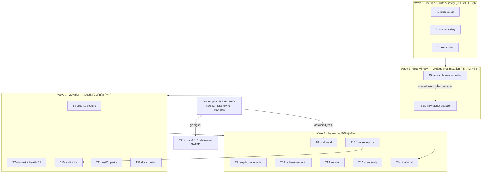

# Post-Audit Pareto Execution Plan

**Date:** 2026-11-19 07:55 CET · **Input:** `TODO_LIST.md` (25 open rows, verified
2026-11-19) + `docs/status/2026-11-19_07-41_library-utilization-fleet-audit-status.md`
§f items 12–37 (not yet routed) + `ROADMAP.md` raw ideas.
**Method:** pareto-planning skill; medium granularity 30–100 min packages (≤27),
fine granularity ≤12 min tasks (ALL todos included). Sorted by
importance/impact/effort/customer-value. Customer = the single operator (Lars);
value = a dashboard that tells the truth, never breaks sibling services, and
amortizes fleet plumbing.

**Errata (Step-0 verification):** TODO_LIST was groomed by the 2026-11-19 00-53
re-review and the 11-18 docs-health harvest; rows cite evidence and the list header
claims verified status. The M27/M18 items of the 11-17 plan are closed per
`docs/status/2026-11-18_15-00_final-pass-plan-complete.md`. No stale rows found on
read-through. One supersession: the Blocked row "Push master to remotes" is executed
by this session's explicit push directive (the block was "never push unless asked" —
we were asked).

---

## 1. Pareto Breakdown

### The 1% that delivers 51% — stop the hub from lying and from breaking siblings

Three defects, one theme: **the product IS truth about the fleet, and today three
holes undermine it.**

~~1. **T1 — Discovery SSE parser is lossy** (`client.go:184-201`): drops multi-line~~ done — daemon.ParseSSEData rewires discovery/client.go; multi-line frames + loud over-cap failure spec'd (14-43 §a1)
   `data:` frames, never checks `scanner.Err()` → read errors look like clean EOF on
   the liveness input that drives `never-covered`. The dashboard can silently show
   wrong fleet membership.
~~2. **T2 — Second hub instance steals a live daemon's socket** (`bind.go:46`~~ done — probe-first removeUnownedSocket + daemon.IsSocketAlive; live-sibling steal repro test (14-43 §a2)
   unconditional `os.Remove`): starting a second `compliance-hub serve` (stale
   systemd unit, fat-fingered CLI) silently kills the first one's socket path.
~~3. **T3 — Default `--source file` has NO write trigger**; even `--source cache`~~ done — go-filewatcher v2.5.0 dir-watch on WAL sidecars + evidence renames (14-43 §a5)
   sees only this process's writes (5-min safety net). The "realtime" dashboard is
   up to 5 minutes stale by construction on its core promise.

### The 4% that delivers 64% — make exits and patches honest

~~4. **T4 — Exit-code contract**: transient cache failures exit generic 1 instead of~~ done — errorfamily.ExitCode in main.go; sysexits suite + e2e 75 (14-43 §a3)
   the fleet-standard classification; systemd restart semantics and operator
   muscle-memory both depend on exit codes.
~~5. **T5 — Version/de-dup window**: go-datastar v0.6.x is exposed to a 24h~~ done — go-sse v0.7.0, go-datastar v0.7.0 + static v0.8.0; ScriptHandler ETag/304; MemoryStore (14-43 §a4)
   stale-JS-client window (fixed by v0.7 `ScriptTagVersioned`); `ringStore`
   re-implements `datastar.MemoryStore` line-for-line; go-sse is one additive minor
   behind. One `go.mod` mutation window pays for all of it.

### The 20% that delivers 80% — security posture, CLI value, and audit durability

~~6. **T6 — Security posture**: GO-2026-6859 (net/http race, re-flagged every~~ done — toolchain go1.27.4 (govulncheck 0), SECURITY.md, nosniff middleware (14-43 §a6-8)
   buildflow run), missing SECURITY.md (error-severity finding every run), no
   `nosniff` on a real browser surface. Three recurring CI findings die at once.
~~7. **T7 — CLI value**: `--format` flag (16 go-output formats already in the module~~ done — table --format (11 formats) + health.Off cache-disk (14-43 §a9)
   graph, ~25 lines), `health.Off` for unconfigured deps.
~~8. **T10 — Audit infrastructure**: citation-check script (turns 6/20 QC sampling~~ done — check-citations.sh + citation-gate CI; screenshot owner-blocked (TODO row) (15-50 §a6)
   into 20/20 mechanical verification), index screenshot run-trace.
~~9. **T11 — Test/CI parity**: core `-race` parity, `templ fmt` gate, README health~~ done — core -race row, templ-fmt gate, README threshold pin, serve.go comment (15-50 §a4)
   thresholds pinned by contract test.
~~10. **T12 — Docs routing**: flip-triggers out of entombment into ROADMAP~~ done — ROADMAP conditions-watched + README review-libs link + AGENTS rows (15-50 §a12)
    conditions-watched; `docs/review/libs/` discoverable.

### The other 20% to reach 100%

~~11. **T8** cmdguard deepening (lint CI gate, AssertDescribeContract, upstream Nd codec).~~ done — cmdguard usage gate CI; AssertDescribeContract verified master-only → next tag (15-50 §a7)
~~12. **T9** templ-components pass (errorpage, ThemeToggle, Play CDN → compiled CSS).~~ done — errorpage 404 + ThemeToggle + compiled CSS pipeline (15-50 §a8)
~~13. **T13** docs hygiene (archive sweep). **T14** verification ritual (all-systems~~ done — archive sweep done, all-systems flake green, both reports written, io anomaly NOT-DO, lychee clean, tag shipped (15-50 §a9-13)
    flake check, final gate pass). **T15** audit completeness (go-branded-id,
    go-sqlitestore reports). **T17** io-history anomaly. **T18** lychee + semantic
    audit of 22 token-matched items. **T21** core v0.1.0 release pass (gated).
14. **Owner gate** (not schedulable by agents): FLAKE_PAT secrets, repo visibility, **→ owner gate — TODO_LIST Blocked rows (FLAKE_PAT, M26 g2, visibility, VACUUM/cache-DB, SSE owner, upstream mandate)**
    M26 overview endgame (g2), VACUUM + cache-DB deletion, fleet SSE-parser
    canonical owner, cross-repo upstream mandate.

---

## 2. Comprehensive Plan — medium granularity (30–100 min packages)

Order = execution priority. Effort sums to ≈17 h of agent-executable work.

| #   | Package                                                                                                                 | Delivers (customer value)                             | Impact | Effort     | Depends on             | Tier    |
| --- | ----------------------------------------------------------------------------------------------------------------------- | ----------------------------------------------------- | ------ | ---------- | ---------------------- | ------- |
| ~~T1~~ done — daemon.ParseSSEData + specs (14-43 §a1) | ~~Discovery SSE parser → `daemon.ParseSSEData` + tests~~ | ~~Fleet membership truth; kills a gopls warning class~~ | ~~High~~ | ~~60m~~ | ~~—~~ | ~~1%~~ |
| ~~T2~~ done — removeUnownedSocket + IsSocketAlive repro-first (14-43 §a2) | ~~Socket-safety: probe-first cleanup (`CleanStaleSocket` semantics or `Server.Start` lifecycle) + refusal test~~ | ~~No silent sibling kill; −90 LOC hand-roll~~ | ~~High~~ | ~~90m~~ | ~~—~~ | ~~1%~~ |
| ~~T3~~ done — watcher.go WAL dir-watch adopted (14-43 §a5) | ~~go-filewatcher adoption (dir-watch WAL sidecars + evidence renames; STACK row; vendorHash ×2 sites)~~ | ~~Realtime promise kept: 5 min → ~1-2 s~~ | ~~High~~ | ~~100m~~ | ~~T5 (one go.mod window)~~ | ~~1%~~ |
| ~~T4~~ done — errorfamily.ExitCode + suite (14-43 §a3) | ~~Exit-code contract (`errorfamily.ExitCode` in main.go)~~ | ~~Correct systemd restarts + operator signal~~ | ~~Med~~ | ~~30m~~ | ~~—~~ | ~~4%~~ |
| ~~T5~~ done — v0.7.0 lockstep + ScriptHandler + MemoryStore (14-43 §a4) | ~~Version window: go-sse→v0.7.0, go-datastar→v0.7/v0.8 lockstep, `ScriptTagVersioned`, `ringStore`→`MemoryStore`~~ | ~~Kills 24h stale-JS window; −40 LOC dup~~ | ~~Med~~ | ~~90m~~ | ~~—~~ | ~~4%~~ |
| ~~T6~~ done — go1.27.4 + SECURITY.md + nosniff (14-43 §a6-8) | ~~Security: GO-2026-6859 bump + govulncheck, SECURITY.md, nosniff wrap~~ | ~~3 recurring CI findings die; browser surface hardened~~ | ~~Med~~ | ~~60m~~ | ~~—~~ | ~~20%~~ |
| ~~T7~~ done — format + health.Off (14-43 §a9) | ~~CLI value: `--format` flag, `health.Off` for cache-disk~~ | ~~16 output formats unlocked at zero deps~~ | ~~Med~~ | ~~60m~~ | ~~—~~ | ~~20%~~ |
| ~~T10~~ done — citation script + gate; screenshot routed (15-50 §a6) | ~~Audit infra: citation-check script + run over 20 reports; index screenshot~~ | ~~Future audits mechanically verified~~ | ~~Med~~ | ~~60m~~ | ~~—~~ | ~~20%~~ |
| ~~T11~~ done — race row, templ-fmt gate, threshold pin, comment (15-50 §a4) | ~~Test/CI parity: core `-race`, templ fmt gate, README threshold pin, serve.go comment~~ | ~~Gates match reality; drift fails CI~~ | ~~Med~~ | ~~45m~~ | ~~—~~ | ~~20%~~ |
| ~~T12~~ done — ROADMAP watched + README link + AGENTS rows (15-50 §a12) | ~~Docs routing: flip-triggers→ROADMAP, review-libs link, AGENTS command rows~~ | ~~Findings findable; no entombment~~ | ~~Med~~ | ~~30m~~ | ~~—~~ | ~~20%~~ |
| ~~T8~~ done — usage gate CI; contract deferred to next tag (15-50 §a7) | ~~cmdguard: lint CI gate + AssertDescribeContract (if tag) + upstream Nd TODO~~ | ~~Fleet CLI standard enforced~~ | ~~Med~~ | ~~60m~~ | ~~—~~ | ~~rest~~ |
| ~~T9~~ done — errorpage + ThemeToggle + compiled CSS (15-50 §a8) | ~~templ-components: errorpage, ThemeToggle, Play CDN→compiled CSS, embedlit hint~~ | ~~CSP-safe prod UI; polished errors~~ | ~~Med~~ | ~~100m~~ | ~~—~~ | ~~rest~~ |
| ~~T15~~ done — both reports written; index at 22 (15-50 §a9) | ~~Utilization reports: go-branded-id, go-sqlitestore~~ | ~~Audit covers 100% of the dep graph~~ | ~~Low~~ | ~~60m~~ | ~~—~~ | ~~rest~~ |
| ~~T18~~ done — items struck; lychee 0; exclusions moot (15-50 §a10) | ~~lychee 4-file verdict + semantic audit of 22 token-matched items~~ | ~~Docs-gates green becomes trustworthy~~ | ~~Low~~ | ~~60m~~ | ~~—~~ | ~~rest~~ |
| ~~T13~~ done — 2 reports archived with manifest (15-50 §a11) | ~~Docs hygiene: archive sweep + manifest~~ | ~~Cadence gate unblocks~~ | ~~Low~~ | ~~30m~~ | ~~—~~ | ~~rest~~ |
| ~~T14~~ done — battery green; --all-systems exit 0 (15-50 §a13) | ~~Verification ritual: `nix flake check --all-systems` + full final gate pass~~ | ~~Ship confidence; platform status known~~ | ~~Low~~ | ~~30m~~ | ~~T1–T9~~ | ~~rest~~ |
| ~~T17~~ **NOT-DO — io anomaly explained via io_metrics (files_hashed tracks tree churn); no defect (15-50 §a12).** | ~~io-history-ratchet anomaly (`--profile-io`)~~ | ~~Explains buildflow noise (43 vs 16)~~ | ~~Low~~ | ~~30m~~ | ~~—~~ | ~~rest~~ |
| T21 **→ v0.1.0 shipped (77881b3) but predates the Wave core splits; replace-drop executes at the next core tag (TODO_LIST row)** | Core v0.1.0 release pass: checklist, drop hub `replace`, tidy, hash check (GATED on owner go) | Publishable core; simpler hub module | High | 30m | owner gate | gated |
| OG **→ owner gate — TODO_LIST Blocked rows (FLAKE_PAT, M26 g2, visibility, VACUUM/cache-DB, SSE owner, upstream mandate)** | Owner gate: FLAKE_PAT, repo visibility, M26 g2, VACUUM, cache-DB delete, SSE-canonical-owner decision, upstream mandate | Unblocks CI, publishing, fleet convergence | High | owner time | — | blocked |

Not scheduled (kept RAW in ROADMAP): fleet-wide adoption waves (go-daemon
`Server.Start`, cmdguard `AssertDescribeContract`, go-output `--format`,
`health.Off` idiom), hub v2 wire, federation B/C/D — all demand-gated per ROADMAP.

---

## 3. Fine Breakdown — ≤12 min tasks (ALL todos)

69 micro-tasks. IDs map to packages above; each ends with its package's gate
(build+vet+lint+tests where code is touched — SEQUENTIAL test runs per AGENTS.md).

| ID    | Task                                                                                   | ≤   | Impact | Tier    |
| ----- | -------------------------------------------------------------------------------------- | --- | ------ | ------- |
| ~~1.1~~ done — ParseSSEData swap live in client.go | ~~Swap discovery client scanner loop for `daemon.ParseSSEData`; drop hand-rolled buffers~~ | ~~12m~~ | ~~High~~ | ~~1%~~ |
| ~~1.2~~ done — frame + over-cap specs green | ~~Tests: multi-line `data:` frames reassembled; read-error surfaces (no fake EOF)~~ | ~~12m~~ | ~~High~~ | ~~1%~~ |
| ~~1.3~~ done — gopls warning gone (LSP-verified) | ~~Verify gopls scanner warning gone; full gate green~~ | ~~12m~~ | ~~High~~ | ~~1%~~ |
| ~~2.1~~ done — steal test written first, watched FAIL | ~~Test first: second bind against a live socket must FAIL (reproduces today's steal)~~ | ~~12m~~ | ~~High~~ | ~~1%~~ |
| ~~2.2~~ done — probe-first cleanup adopted | ~~Adopt probe-first stale-socket cleanup (go-daemon `CleanStaleSocket` semantics)~~ | ~~12m~~ | ~~High~~ | ~~1%~~ |
| ~~2.3~~ done — minimal-probe decided, STACK.md recorded | ~~Decide minimal-probe vs full `Server.Start` adoption; record in STACK/AGENTS~~ | ~~12m~~ | ~~High~~ | ~~1%~~ |
| ~~2.4~~ done — ordering untouched; -race green | ~~Preserve sd_notify/watchdog ordering; `-race` suite green~~ | ~~12m~~ | ~~High~~ | ~~1%~~ |
| ~~2.5~~ done — go-daemon.md addendum + AGENTS | ~~Update go-daemon.md report + AGENTS.md (adopted surface)~~ | ~~12m~~ | ~~Med~~ | ~~1%~~ |
| ~~3.1~~ done — STACK row + decision log entry | ~~STACK.md foundation row + decision-log entry for go-filewatcher~~ | ~~12m~~ | ~~Med~~ | ~~1%~~ |
| ~~3.2~~ done — dir-watch wired into refresher | ~~Wire dir-watch (filter `<db>`,`-wal`,`-shm` + evidence dir) into refresher~~ | ~~12m~~ | ~~High~~ | ~~1%~~ |
| ~~3.3~~ done — evidence-watch check via Healthy() | ~~`Healthy()` → go-health check; safety net stays as backstop~~ | ~~12m~~ | ~~High~~ | ~~1%~~ |
| ~~3.4~~ done — package-site hash converged first paste | ~~vendorHash bootstrap site 1 (`compliance-hub` package)~~ | ~~12m~~ | ~~Med~~ | ~~1%~~ |
| ~~3.5~~ done — devShell-site hash converged | ~~vendorHash bootstrap site 2 (CI devShell) + convergence confirm~~ | ~~12m~~ | ~~Med~~ | ~~1%~~ |
| ~~3.6~~ done — cross-process ≤2s spec under -race | ~~Test: cross-process SQLite write → refresh ≤2 s (WAL sidecar event)~~ | ~~12m~~ | ~~High~~ | ~~1%~~ |
| ~~3.7~~ done — flake check green; limitation paragraph gone | ~~`nix flake check`; shrink AGENTS.md "documented limitation" paragraph~~ | ~~12m~~ | ~~Med~~ | ~~1%~~ |
| ~~4.1~~ done — ExitCode in main.go + suite | ~~`errorfamily.ExitCode(err)` in main.go + classification→exit test~~ | ~~12m~~ | ~~Med~~ | ~~4%~~ |
| ~~4.2~~ done — README Exit-codes section | ~~Document exit codes (README or AGENTS table row)~~ | ~~12m~~ | ~~Low~~ | ~~4%~~ |
| ~~5.1~~ done — go-sse v0.7.0; suite green | ~~Bump go-sse v0.7.0; hub suite green~~ | ~~12m~~ | ~~Med~~ | ~~4%~~ |
| ~~5.2~~ done — datastar/static lockstep bumped | ~~Bump go-datastar v0.7.0 + static v0.8.0 lockstep; check templ-components constraint~~ | ~~12m~~ | ~~Med~~ | ~~4%~~ |
| ~~5.3~~ done — ScriptHandler ETag/304 + 304 spec | ~~Replace hand-rolled `/datastar.js` handler with `ScriptTagVersioned` (ETag/304)~~ | ~~12m~~ | ~~Med~~ | ~~4%~~ |
| ~~5.4~~ done — ringStore deleted; MemoryStore; replay green | ~~Delete `ringStore`; use `datastar.MemoryStore`; replay tests green~~ | ~~12m~~ | ~~Med~~ | ~~4%~~ |
| ~~5.5~~ done — ssetest stays v0.5.0 (no newer tag; ROADMAP watch) | ~~Align datastartest/ssetest pins to the new minors~~ | ~~12m~~ | ~~Low~~ | ~~4%~~ |
| ~~5.6~~ done — tidied in the T3 go.mod window | ~~Per-module `go mod tidy`; vendorHash check (share window with T3)~~ | ~~12m~~ | ~~Med~~ | ~~4%~~ |
| ~~6.1~~ done — toolchain go1.27.4; govulncheck 0 | ~~Toolchain bump for GO-2026-6859; govulncheck 0 reachable~~ | ~~12m~~ | ~~Med~~ | ~~20%~~ |
| ~~6.2~~ done — SECURITY.md; wording fixed to 0 findings | ~~Write SECURITY.md (root/.github/docs lookup path)~~ | ~~10m~~ | ~~Med~~ | ~~20%~~ |
| ~~6.3~~ done — middleware + serve E2E header assert | ~~nosniff middleware wrap in serve.go + header test~~ | ~~12m~~ | ~~Med~~ | ~~20%~~ |
| ~~6.4~~ done — three recurring findings confirmed dead | ~~buildflow re-run: the three recurring findings gone~~ | ~~12m~~ | ~~Med~~ | ~~20%~~ |
| ~~7.1~~ done — format with 11 formats | ~~`--format` flag on fleet-table path (go-output RenderTable wiring)~~ | ~~12m~~ | ~~Med~~ | ~~20%~~ |
| ~~7.2~~ done — round-trip + ANSI-free format specs | ~~Format tests: json/csv/markdown round-trips~~ | ~~12m~~ | ~~Low~~ | ~~20%~~ |
| ~~7.3~~ done — health.Off + five-check payload spec | ~~`health.Off` for unconfigured cache-disk; readiness payload test~~ | ~~12m~~ | ~~Med~~ | ~~20%~~ |
| ~~7.4~~ done — cmdguard contract limit documented in table.go | ~~Wire `--format` into cmdguard output plumbing if the contract allows~~ | ~~12m~~ | ~~Low~~ | ~~20%~~ |
| ~~10.1~~ done — check-citations.sh (423+ cites/run) | ~~Write citation-check script (extract file:line cites → verify existence/range)~~ | ~~12m~~ | ~~Med~~ | ~~20%~~ |
| ~~10.2~~ done — run over all reports; baseline ratchet | ~~Run script over all 20 reports; capture report~~ | ~~12m~~ | ~~Med~~ | ~~20%~~ |
| ~~10.3~~ done — 29 drift cites adjudicated with addenda | ~~Fix/annotate every stale citation found~~ | ~~12m~~ | ~~Med~~ | ~~20%~~ |
| 10.4 **→ TODO_LIST Low row — firefox permission-blocked in agent sessions** | Screenshot index.html (needs firefox permission) → docs/assets; link from index | 12m | Low | 20% |
| ~~10.5~~ done — AGENTS tag-watch hook line | ~~AGENTS.md: go-daemon tag-watch hook (report addendum at next tag)~~ | ~~5m~~ | ~~Low~~ | ~~20%~~ |
| ~~11.1~~ done — core -race parity + AGENTS row | ~~Core module `-race -count=1` run + AGENTS.md commands row~~ | ~~12m~~ | ~~Med~~ | ~~20%~~ |
| ~~11.2~~ done — templ-fmt CI gate job | ~~`templ fmt` CI gate job~~ | ~~12m~~ | ~~Low~~ | ~~20%~~ |
| ~~11.3~~ done — thresholds pinned by contract test | ~~Pin README health thresholds in `/readyz` contract test~~ | ~~12m~~ | ~~Med~~ | ~~20%~~ |
| ~~11.4~~ done — serve.go goroutine-window comment | ~~serve.go goroutine-window clarifying comment~~ | ~~5m~~ | ~~Low~~ | ~~20%~~ |
| ~~12.1~~ done — ROADMAP Conditions watched (11 triggers) | ~~Flip-triggers table (11 libs) → ROADMAP "conditions watched"~~ | ~~12m~~ | ~~Med~~ | ~~20%~~ |
| ~~12.2~~ done — README Documentation links review-libs | ~~Link docs/review/libs from README docs section~~ | ~~5m~~ | ~~Low~~ | ~~20%~~ |
| ~~12.3~~ done — AGENTS exit-code probe row | ~~AGENTS.md commands: exit-code policy line (redirect+echo)~~ | ~~5m~~ | ~~Low~~ | ~~20%~~ |
| ~~12.4~~ done — AGENTS devShell-build ritual row | ~~AGENTS.md commands: devShell build in verification ritual~~ | ~~5m~~ | ~~Low~~ | ~~20%~~ |
| ~~8.1~~ done — cmdguard-lint CI job (pinned recipe) | ~~cmdguard-lint CI job (hub passes every rule today — gate it)~~ | ~~12m~~ | ~~Med~~ | ~~rest~~ |
| ~~8.2~~ done — verified master-only; adoption at next tag (TODO row) | ~~Adopt `AssertDescribeContract` if next cmdguard tag ships it~~ | ~~12m~~ | ~~Med~~ | ~~rest~~ |
| 8.3 **→ owner mandate gate — ROADMAP owner decisions (upstream-TODO queue)** | File upstream Nd-duration-codec TODO in cmdguard repo (needs mandate) | 12m | Med | rest |
| ~~9.1~~ done — styled 404 via errorpage; /{$} exact root | ~~`errorpage` for Go-default 404s~~ | ~~12m~~ | ~~Med~~ | ~~rest~~ |
| ~~9.2~~ done — ThemeToggle + ThemeScript shipped | ~~`layout.ThemeToggle`~~ | ~~12m~~ | ~~Low~~ | ~~rest~~ |
| ~~9.3~~ done — compiled CSS pipeline (regen-ui.sh) | ~~Play CDN → compiled CSS pipeline (config)~~ | ~~12m~~ | ~~Med~~ | ~~rest~~ |
| ~~9.4~~ done — CSP regression specs green | ~~Verify CSP-safety of the compiled pipeline (no inline config block)~~ | ~~12m~~ | ~~Med~~ | ~~rest~~ |
| ~~9.5~~ done — FALSE POSITIVE proven; AGENTS verdict | ~~Fix view.templ:46 embedlit hint~~ | ~~5m~~ | ~~Low~~ | ~~rest~~ |
| ~~9.6~~ done — view_test regression + 2KB patch budget | ~~view_test regression + patch-size check (rows stay script-free)~~ | ~~12m~~ | ~~High~~ | ~~rest~~ |
| ~~15.1a~~ done — consumer usage inventory | ~~go-branded-id: read lib + consumer usage inventory~~ | ~~12m~~ | ~~Low~~ | ~~rest~~ |
| ~~15.1b~~ done — report ADOPTED 90 | ~~go-branded-id: write utilization report~~ | ~~12m~~ | ~~Low~~ | ~~rest~~ |
| ~~15.2a~~ done — consumer usage inventory | ~~go-sqlitestore: read lib + consumer usage inventory~~ | ~~12m~~ | ~~Low~~ | ~~rest~~ |
| ~~15.2b~~ done — report ADOPTED 85 | ~~go-sqlitestore: write utilization report~~ | ~~12m~~ | ~~Low~~ | ~~rest~~ |
| ~~18.1~~ done — 0 findings; exclusions moot | ~~lychee: verdict on the 4 path-excluded files~~ | ~~12m~~ | ~~Low~~ | ~~rest~~ |
| ~~18.2~~ done — audit-all items struck with evidence | ~~Semantic audit batch 1 (~8 of 22 token-matched items)~~ | ~~12m~~ | ~~Low~~ | ~~rest~~ |
| ~~18.3~~ done — mis-strike repaired; @substring lesson | ~~Semantic audit batch 2 (~8)~~ | ~~12m~~ | ~~Low~~ | ~~rest~~ |
| ~~18.4~~ done — batch 3 closed; lychee clean | ~~Semantic audit batch 3 (~6); strike or route each~~ | ~~12m~~ | ~~Low~~ | ~~rest~~ |
| ~~13.1~~ done — 2 reports archived + manifest | ~~Archive sweep: `git mv` aged reports + archived README manifest~~ | ~~12m~~ | ~~Low~~ | ~~rest~~ |
| ~~13.2~~ done — docs-gates 5/5 after sweep | ~~docs-gates re-run clean after sweep~~ | ~~12m~~ | ~~Low~~ | ~~rest~~ |
| ~~14.1~~ done — exit 0 (x86_64 + aarch64, 6 checks) | ~~`nix flake check --all-systems` once; record aarch64 status~~ | ~~12m~~ | ~~Low~~ | ~~rest~~ |
| ~~14.2~~ done — final battery green both modules | ~~Final full gate pass both modules (build/vet/lint/tests)~~ | ~~12m~~ | ~~Med~~ | ~~rest~~ |
| ~~17.1~~ done — io_metrics analysis (tree churn) | ~~`buildflow --profile-io` run on the anomaly~~ | ~~12m~~ | ~~Low~~ | ~~rest~~ |
| ~~17.2~~ done — NOT-DO recorded at 23-40 §f30 | ~~Route the io-history finding (fix or ROADMAP)~~ | ~~5m~~ | ~~Low~~ | ~~rest~~ |
| ~~21.1~~ done — v0.1.0 tagged 77881b3 (2026-11-19), proxy-fetchable | ~~Core v0.1.0 release checklist (go-release skill)~~ | ~~12m~~ | ~~High~~ | ~~gated~~ |
| 21.2 **→ TODO_LIST Low row — v0.1.0 predates the Wave core splits; executes at the next core tag** | Drop hub `replace`, tidy both modules, vendorHash check | 12m | Med | gated |
| OG.1 **→ TODO_LIST Blocked row (owner-only secret creation)** | Owner: create FLAKE_PAT secrets (GitHub+Forgejo) | 10m | High | blocked |
| OG.2 **→ TODO_LIST Blocked row (M26 overview endgame, owner g2)** | Owner: decide M26 overview endgame (g2) | — | Med | blocked |
| OG.3 **→ TODO_LIST Blocked rows (repo visibility, VACUUM, cache-DB — owner machine)** | Owner: repo visibility; VACUUM; cache-DB delete | — | Low | blocked |
| OG.4 **→ ROADMAP owner decisions (fleet SSE-parser canonical owner)** | Owner: fleet SSE-parser canonical owner (ParseSSEData vs sseparse) | — | High | blocked |
| OG.5 **→ ROADMAP owner decisions (upstream-TODO mandate)** | Owner: cross-repo upstream-TODO mandate | — | Med | blocked |

---

## 4. Execution Graph



**Why this order:** Wave 1 fixes things that lie to or kill the operator — no
dependency risk, pure code. Wave 2 batches every `go.mod` mutation into ONE
vendorHash ritual (T5 bumps first, T3 adopts second — avoids bootstrapping the
flake twice). Wave 3 is low-risk value. Wave 4 is polish; T14 closes with the
full ritual. T21 waits for the owner's tag signal.

## 5. Guardrails (no verschlimmbessern)

- Every wave ends with the full gate green (build, vet, lint, sequential tests,
  `nix flake check` where go.mod/nix changed). A wave that cannot end green
  reverts its own changes — never leaves the tree worse.
- No speculative rewrites: T2 keeps sd_notify ordering byte-identical; T3 retains
  the 5-min safety net as backstop; T9 must not bloat row patches (9.6 checks it).
- One go.mod mutation window (T5+T3); vendorHash bootstrapped at BOTH flake sites.
- Reports and docs are append/annotate, never rewritten (docs-health ANNOTATE rule).
- Upstream writes (8.3) only with the owner mandate (OG.5).

## 6. Verification ritual (run at every wave boundary)

```bash
GOWORK=off go build ./... && GOWORK=off go vet ./...
golangci-lint run ./...
cd hub && GOWORK=off go build ./... && GOWORK=off go vet ./... \
  && golangci-lint run -c ../.golangci.yml ./...
# tests SEQUENTIALLY (shared GOCACHE):
GOWORK=off go test -race -count=1 ./...
cd hub && GOWORK=off go test -race -count=1 ./...
nix flake check   # after any go.mod / nix / templ change
```

— Plan written 2026-11-19 07:55 CET. Snapshot: once executed, harvest per
docs-health; do not edit this file in place.
