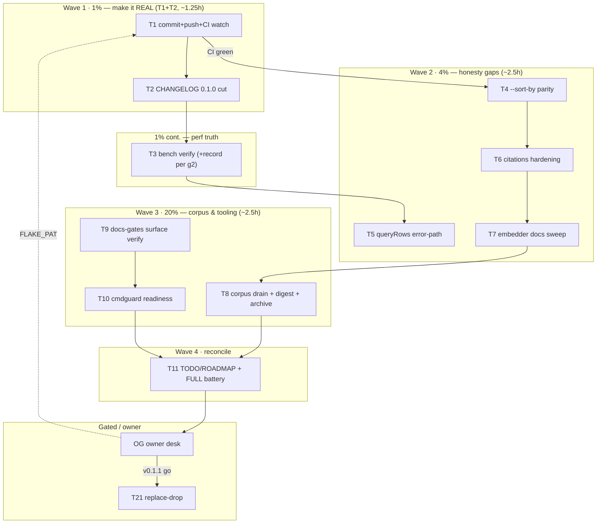

# Corpus-Drain & CI-Activation Pareto Plan — go-compliance

**Date:** 2026-11-19 21:25 CET · **Author:** Crush (glm-5.3-flash), pareto-planning
skill · **Inputs read:** `TODO_LIST.md` (17 open rows after errata), `ROADMAP.md`,
the 4 unarchived status reports, this session's 21-17 docs-health report, prior
plans (all three archived 2026-11-19 — their M/WP/T universes are CLOSED; nothing
re-dispatched from them).
**Customer definition (for value sorting):** Lars, the single operator, first —
a repo whose gates HAVE RUN, whose release history is true, and whose open-item
corpus is drained to owner-decisions only. Embedders second, fleet convergence
third.
**Format note:** the pareto-planning skill defaults to a styled HTML report; the
owner explicitly requested **an .md file with a mermaid.js execution graph** —
that instruction wins (same precedent as the 2026-11-17 plan).

**Errata (Step-0 verification of the backlog — 3 rows removed from TODO_LIST):**

1. "Importance column decision" — not blocked but DECIDED
   (producer-side-forever, GC5; recorded in ROADMAP + docs/decisions/v2-wire-design.md).
   A decision is not a task; row removed.
2. "`nix flake check --all-systems` once" — DONE 2026-11-19 (16-12 §a2: exit 0,
   x86_64 + aarch64, 6 checks). Completed TODO rows live in CHANGELOG, not
   TODO_LIST; row removed.
3. "Push master to remotes" — the owner's planning directive explicitly orders
   `git push`; the block was "never push unless asked — we were asked". Row
   removed; execution is task 1.2/1.3 below.

**Anti-verschlimmbessern rules for every task:** no speculative rewrites; every
change leaves build+tests+lint-delta verifiably no worse; sequential `go test`
runs only (shared GOCACHE); templ regen after any `.templ` edit; daemon owns
commits unless the owner asks (asked: task 1.1); no new deps without a STACK.md
row; annotate historical files, never rewrite them.

---

## 1. Pareto Breakdown

### The 1% that delivers 51% — make the gates REAL and the release history TRUE

The repo is built, superbly documented, and gated — but four CI gates have never
executed on a real runner, the CHANGELOG pretends nothing shipped (no `[0.1.0]`
section under a live tag), and the perf claim rests on a pre-Wave baseline.
Roughly two hours collapses all of it:

1. **T1 — Push + CI activation + first-run watch.** The owner ordered the push;
   it activates the four zero-run gates and starts the CI-watch story.
2. **T2 — CHANGELOG `[0.1.0]` cut** at the tag boundary (77881b3): `[Unreleased]`
   stops mixing pre- and post-tag work; pkg.go.dev visitors get a truthful
   release section.
3. **T3 — Bench verify (+ re-record per the owner's answer)**: proves or retires
   the FEATURES "fold @341 ≈ 150µs" claim on the current tree.

### The 4% that delivers 64% — close the honesty gaps a reviewer would find

4. **T4 — Hub `table --sort-by` flag parity** (producer carries
   findings/failures/name; hub hardcodes state-rank order). The last flag-parity
   drift a BuildFlow user would notice.
5. **T5 — `queryRows` error-path test**: the SQL seam's wrapped IO-errors are
   pinned only by construction.
6. **T6 — check-citations hardening**: shellcheck the script, pin `rg` on the
   runner — the citation gate survives runner-image drift.
7. **T7 — Embedder-docs five-checks sweep**: examples + integrate.md predate the
   newer health checks.

### The 20% that delivers 80% — drain the corpus, align the tooling

8. **T8 — Open-corpus drain**: strike the verifiably-done subset of the 4
   remaining reports, write the owner-decisions digest, archive 23-40 + 00-53
   behind it. Unarchived count 5 → 3, all holding only true owner gates.
9. **T9 — docs-gates surface verify**: the installed binary lacks the `rows`/`--pre-flight`
   verbs the skill documents; pin-bump or skill-errata verdict.
10. **T10 — cmdguard next-tag readiness**: AssertDescribeContract adoption notes
    - upstream-issue drafts (drafts only — filing waits on the mandate).
11. **T11 — Reconcile + full battery**: TODO_LIST/ROADMAP truth, every gate green
    (docs-gates, dprint, row gates, build/vet/`-race` both modules sequential,
    art-dupl, actionlint).

### The other 20% (to reach 100%)

12. **T21 — Hub `replace` drop** (GATED on the owner's v0.1.1 go-signal):
    require v0.1.1-class tag, drop `=> ../`, tidy, vendorHash ritual at both
    flake sites, simplify the `_core_only` story.
13. **OG — Owner desk** (not schedulable by agents): FLAKE_PAT secrets, M26
    overview endgame (g2), Forgejo visibility, go-humanize + samber/lo verdicts,
    upstream-TODO mandate (5 candidates queued in ROADMAP), VACUUM + cache-DB
    hygiene, firefox permission.
14. **Kept RAW in ROADMAP (demand-gated, deliberately NOT scheduled):** hub v2
    wire, federation B/C/D, fleet adoption waves (go-daemon `Server.Start`,
    cmdguard contract, go-output `--format`, `health.Off`), WorstStepLimit
    branded type, templ-components tickable mode, art-dupl calibration, dashboard
    UI ideas (CSS diff budget, visual smoke, HEAD test), ssetest pin watch.

---

## 2. Comprehensive Plan — medium granularity (30–100 min each, ALL TODOs)

Sorted by importance → impact → effort → customer value. **Gates:** T21 gated on
the owner v0.1.1 signal; OG is owner-only.

| #   | Package                                                                                                        | Delivers (customer value)                            | Impact | Effort | Depends on    | Tier    |
| --- | -------------------------------------------------------------------------------------------------------------- | ---------------------------------------------------- | ------ | ------ | ------------- | ------- |
| T1  | Commit (detailed msg) + push origin + mirror; watch the four zero-run gates' first real executions; triage     | Gates become EVIDENCE, not YAML; CI-watch row closes | High   | 30m    | —             | 1%      |
| T2  | CHANGELOG `[0.1.0]` cut at the 77881b3 boundary; `[Unreleased]` keeps post-tag waves                           | Release history true for pkg.go.dev + future cuts    | Med    | 45m    | —             | 1%      |
| T3  | Bench verify on the current tree (+ re-record per owner answer to g2)                                          | FEATURES perf claim proven or retired                | Med    | 30m    | g2 (answer)   | 1%      |
| T4  | Hub `table --sort-by` (findings/failures/name) parity with the producer                                        | BuildFlow muscle memory works on the hub CLI         | Med    | 60m    | —             | 4%      |
| T5  | `queryRows` error-path specs (wrapped message strings + error family)                                          | The SQL seam can't regress silently                  | Med    | 30m    | —             | 4%      |
| T6  | check-citations.sh shellcheck + `rg` pinned (or grep fallback) in the citation-gate job                        | Citation gate survives runner drift                  | Med    | 45m    | —             | 4%      |
| T7  | examples/reporter + docs/guides/integrate.md carry the five health-check names                                 | Embedders read the truth                             | Low    | 30m    | —             | 4%      |
| T8  | Corpus drain: strike done-subset in 23-09/23-40/00-53, write the owner-decisions digest, archive 23-40 + 00-53 | Unarchived corpus = true owner gates only (5 → 3)    | Med    | 60m    | —             | 20%     |
| T9  | docs-gates installed-pin vs skill surface (`rows`, `--pre-flight`): verdict + fix (pin bump or skill errata)   | The documented ritual matches the installed tool     | Low    | 30m    | —             | 20%     |
| T10 | cmdguard next-tag readiness: tag watch, adoption sketch, upstream drafts (github-voice, unsent)                | Next tag flips to adoption in minutes, not hours     | Low    | 30m    | OG.5 (filing) | 20%     |
| T11 | TODO_LIST/ROADMAP reconcile + full gate battery (both modules `-race` sequential + docs-gates + dprint + dupl) | The tree's truth, re-proven end-to-end               | Med    | 30m    | T1–T10        | 20%     |
| T21 | Hub replace-drop: require v0.1.1, drop `=> ../`, tidy, vendorHash ×2, `_core_only` simplification (GATED)      | Simpler hub module; proxy-first builds               | High   | 30m    | OG.8 (signal) | gated   |
| OG  | Owner desk: FLAKE_PAT; M26 g2; visibility; go-humanize/samber-lo; upstream mandate; VACUUM + cache-DB; firefox | Un-skips CI, publishing, fleet convergence           | High   | owner  | —             | blocked |

**Total: 11 agent-executable packages ≈ 7h + 1 gated package + owner desk.**

---

## 3. Fine Breakdown — ≤12 min tasks (ALL todos)

Global sort: tier first, then importance/impact/effort. IDs are `T#.-task#`.

| ID   | Task                                                                                                                                 | ≤   | Impact | Tier    |
| ---- | ------------------------------------------------------------------------------------------------------------------------------------ | --- | ------ | ------- |
| 1.1  | Commit plan + backlog reconcile with the detailed message (per the owner's commit directive)                                         | 5m  | High   | 1%      |
| 1.2  | `git push origin master` (Forgejo primary)                                                                                           | 2m  | High   | 1%      |
| 1.3  | `git push github master` (mirror)                                                                                                    | 2m  | High   | 1%      |
| 1.4  | Open the runners' job lists; record first-run outcomes of citation-gate, css-freshness, cmdguard-usage, templ-fmt                    | 10m | High   | 1%      |
| 1.5  | Triage any red job (runner-image drift is the expected failure class); fix or file with evidence                                     | 5m  | High   | 1%      |
| 1.6  | Update the TODO CI-watch row with outcomes; strike it when all four are green                                                        | 5m  | Med    | 1%      |
| 2.1  | Draw the tag boundary: `git log v0.1.0..HEAD --oneline` + classify each CHANGELOG entry pre/post-tag                                 | 10m | Med    | 1%      |
| 2.2  | Create `## [0.1.0] - 2026-11-19`; move the pre-tag entries verbatim (append-only discipline)                                         | 12m | Med    | 1%      |
| 2.3  | Prune `[Unreleased]` to post-tag work; keep keep-a-changelog section order intact                                                    | 10m | Med    | 1%      |
| 2.4  | dprint + docs-gates re-run (the battery judges CHANGELOG prose too)                                                                  | 5m  | Low    | 1%      |
| 3.1  | `GOWORK=off go test -bench . -run '^$' -benchtime 1x` (core: fold/derive/pipeline shapes)                                            | 10m | Med    | 1%      |
| 3.2  | Compare against `benchmarks/baseline.txt`; report deltas in the report                                                               | 5m  | Med    | 1%      |
| 3.3  | IF owner says re-record (g2): write new baseline + update the FEATURES row evidence                                                  | 10m | Low    | 1%      |
| 4.1  | Read producer `--sort-by` surface (`buildflow compliance --help`) + hub `QueryFlags`/table path                                      | 10m | Med    | 4%      |
| 4.2  | Implement `--sort-by` (findings/failures/name; default stays state-rank+failures) in the hub table path                              | 12m | Med    | 4%      |
| 4.3  | Table tests per sort key + default-order regression pin                                                                              | 12m | Med    | 4%      |
| 4.4  | Flag-parity note in README/AGENTS (producer parity table)                                                                            | 5m  | Low    | 4%      |
| 4.5  | Hub gates: build+vet+`-race`+lint sequential                                                                                         | 10m | Med    | 4%      |
| 5.1  | Specs: force IO errors through `queryRows`/`wrapIterateErr`; assert wrapped message + family                                         | 12m | Med    | 4%      |
| 5.2  | Edge: empty-result path + migration-idempotence interplay                                                                            | 10m | Med    | 4%      |
| 5.3  | Cache suite + lint + dupl gate green                                                                                                 | 8m  | Low    | 4%      |
| 6.1  | `shellcheck scripts/check-citations.sh`; fix every finding                                                                           | 12m | Med    | 4%      |
| 6.2  | Pin `rg` in the citation-gate job (nix shell or install step) or add the grep-fallback path                                          | 10m | Med    | 4%      |
| 6.3  | ci.yml update + actionlint                                                                                                           | 5m  | Low    | 4%      |
| 6.4  | Local citation-gate re-run (baseline ratchet stays clean)                                                                            | 5m  | Low    | 4%      |
| 6.5  | Optional: external-cites probe design note (`~/projects/<lib>` verification) — note only, no enforcement                             | 10m | Low    | 4%      |
| 7.1  | Grep integrate.md + examples for stale/absent check names                                                                            | 5m  | Low    | 4%      |
| 7.2  | Add the five-checks paragraph to docs/guides/integrate.md                                                                            | 10m | Low    | 4%      |
| 7.3  | examples/reporter output/comment refresh + build check                                                                               | 10m | Low    | 4%      |
| 8.1  | 23-09: verify + strike the done subset (§f13 Rows() doc comment exists, §f2 templ-fmt, §f23 scanner, …)                              | 12m | Med    | 20%     |
| 8.2  | 23-40: verify + strike the done subset (§f34/35/41/45 class; keep owner-hygiene items bare)                                          | 12m | Med    | 20%     |
| 8.3  | 00-53: verify + strike the done subset (§f1-7, §f15-20 class; keep 🔵/policy items bare)                                             | 12m | Med    | 20%     |
| 8.4  | Write `docs/status/owner-decisions-digest.md`: every open policy/hygiene item, one row each, source-cited                            | 12m | Med    | 20%     |
| 8.5  | Row gates + `git mv` 23-40 + 00-53 to archived/ + manifest updates                                                                   | 10m | Low    | 20%     |
| 9.1  | Diff installed docs-gates verbs/help vs the skill's documented surface (`rows`, `--strict`, `--pre-flight`)                          | 10m | Low    | 20%     |
| 9.2  | Verdict: fleet docs-gates pin bump OR skill errata note; record where the mismatch lives                                             | 10m | Low    | 20%     |
| 9.3  | Apply the fix; `docs-gates run .` stays 5/5                                                                                          | 5m  | Low    | 20%     |
| 10.1 | Check cmdguard tags for `AssertDescribeContract` (fetch --tags; note the next-tag SHA)                                               | 5m  | Low    | 20%     |
| 10.2 | Write the adoption sketch (where the contract assertions attach in hub/cli tests) — patch-ready, not applied                         | 12m | Low    | 20%     |
| 10.3 | Draft the two upstream issues in github-voice (Nd codec; lint go.mod replace directives) — DRAFTS only                               | 10m | Low    | 20%     |
| 11.1 | TODO_LIST reconcile: strike T1–T10 rows w/ CHANGELOG entries; mint any new rows surfaced                                             | 10m | Med    | 20%     |
| 11.2 | ROADMAP touch-ups (owner-decision queue reflects answers to g1-g3)                                                                   | 5m  | Low    | 20%     |
| 11.3 | FULL battery: docs-gates 5/5 + dprint + row gates + build/vet/`-race` SEQUENTIAL both modules + golangci 0+0 + art-dupl + actionlint | 12m | Med    | 20%     |
| 11.4 | Status report for the execution session                                                                                              | 5m  | Low    | 20%     |
| 21.1 | GATED: verify the v0.1.1-class tag exists + proxy-fetchable                                                                          | 2m  | High   | gated   |
| 21.2 | GATED: drop hub `replace => ../`; tidy both modules                                                                                  | 10m | Med    | gated   |
| 21.3 | GATED: vendorHash bootstrap at BOTH flake sites (package + CI devShell)                                                              | 12m | Med    | gated   |
| 21.4 | GATED: `nix flake check` + both suites green; simplify the `_core_only` postPatchExtra story if clean                                | 10m | Med    | gated   |
| OG.1 | Owner: create FLAKE_PAT (GitHub + Forgejo), read-only Contents on go-daemon                                                          | 10m | High   | blocked |
| OG.2 | Owner: M26 overview endgame (replace vs coexist)                                                                                     | —   | Med    | blocked |
| OG.3 | Owner: Forgejo visibility click                                                                                                      | 5m  | Low    | blocked |
| OG.4 | Owner: go-humanize + samber/lo policy verdicts (gates 6 findings + ~25 withheld rewrites)                                            | 15m | Med    | blocked |
| OG.5 | Owner: upstream-TODO filing mandate (5 queued candidates)                                                                            | 5m  | Med    | blocked |
| OG.6 | Owner: VACUUM buildflow DB (1.04 GB) + delete expendable 0.51 GB cache DB                                                            | 15m | Low    | blocked |
| OG.7 | Owner: mark firefox safe (or take the index screenshot yourself)                                                                     | 2m  | Low    | blocked |
| OG.8 | Owner: v0.1.1 go-signal (unblocks T21)                                                                                               | 2m  | High   | blocked |

**Counts: 50 fine tasks · agent-executable ≈ 6.9h · gated ≈ 34m · OG ≈ owner time.**

---

## 4. Execution Graph

**Critical path:** 1.1 → 1.2/1.3 → 1.4 (the CI truth unlocks everything the gates
claim). Parallelizable after T1: T2/T4/T5/T6 touch disjoint files; T8/T9/T10 are
docs/tooling-only and never touch code.

---

## 5. Execution rules

1. Verify after every task (build + tests green before moving on; sequential).
2. No verschlimmbessern: every change leaves the repo verifiably no worse; no
   speculative rewrites; annotate history, never rewrite it.
3. The plan is a snapshot — TODO_LIST.md stays the living backlog; harvest
   outcomes there (docs-health), annotate this file when items close.
4. Owner gates (OG) and T21 block on the owner's answers to g1-g3; everything in
   Waves 1-4 proceeds without them.
5. Stack frozen by STACK.md; the `replace`-drop (T21) is the only go.mod-structural
   change, and it re-runs the documented vendorHash ritual at both sites.
