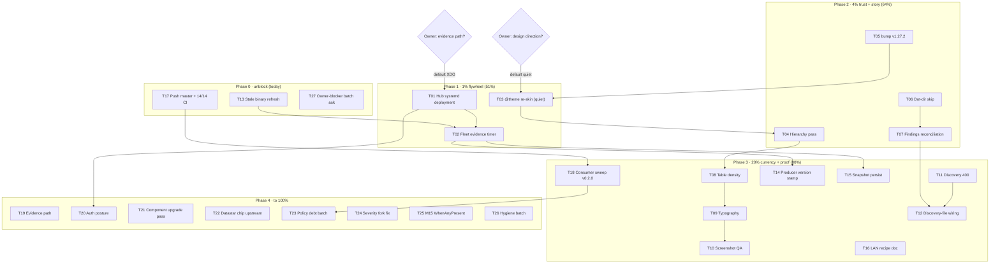

# Fleet Governance 80/20 Execution Plan — library-policy ⇄ go-compliance

**Superseded — [rev 2](2026-11-24_23-15_fleet-governance-80-20-execution-plan-rev2.md).** Verified against code on 2026-11-24 before execution: T17, T23, T24 and T25 were already done, T12 cannot work, and the premises of T01, T02, T07 and T10 were corrected. The errata table in rev 2 cites the evidence per item. The body below is the unmodified 22:36 snapshot apart from the inline verdicts.

**Date:** 2026-11-24 22:36 CET · **Author:** Crush (glm-5.3-flash), pareto-planning skill · **Directive:** owner's 80/20 order (1% → 51%, 4% → 64%, 20% → 80%, rest → 100%); .md + mermaid per the standing owner instruction (precedent: 2026-11-19 plan).
**Inputs read:** `TODO_LIST.md` (24 rows), `docs/status/2026-11-24_22-27_fleet-lan-serve-and-dashboard-ui-audit.md` §f (40 items), `docs/status/2026-11-24_21-34_full-readiness-status-a-to-g.md` (g1–g3), the 2026-11-19 pareto plan (conventions), live code + dashboard DOM/CSS verified this session.
**Customer definition (for value sorting):** Lars the single fleet operator first — a governance loop that RUNS always, is SEEN always, and shows TRUSTWORTHY data at a glance. Embedders second, fleet-wide policy convergence third.
**Sizing:** Level-1 tasks 30–100 min (27 tasks, ALL backlog items covered); Level-2 subtasks ≤12 min each. Level-1 min = sum of its subtasks.

**Decision gates (owner input pending — plan proceeds on recorded defaults):**

| Gate                      | Default this plan assumes                      | Change cost if overridden                              |
| ------------------------- | ---------------------------------------------- | ------------------------------------------------------ |
| Design direction (§g q1)  | **Quiet/disciplined** (tool-grade, data-first) | Re-pick tokens in T03, layout in T04 — hours, not days |
| Evidence path (§g q2)     | XDG `~/.local/state/overview/compliance.json`  | T20 moves it; unit env one-line                        |
| Push/sweep timing (§g q3) | Push authorized by this directive ("git push") | None — already assumed                                 |

**Errata (Step-0 verification — stale/absorbed items removed):**

1. "Take over the session-bound server (pkill + handover)" — superseded by T01: a systemd deployment replaces handover entirely.
2. "Live-reload verification" (§f40) — folded into T02's verification step (same action).
3. "StatusBadge evaluation" (§f19) — folded into T22 (post-bump component pass).
4. TODO_LIST rows already covering persist-snapshot / producer-stamp / consumer-sweep / FLAKE_PAT / benchmark / Forgejo / docs-gates-pin are REFERENCED (T15, T14, T18, T27), not duplicated.
5. Verified still open this session: templ-components pin = v1.27.0 (hub go.mod), zero `@theme` overrides (grep), `.bf-jscpd-worktree` in evidence + Findings "—" (live DOM), CI css-freshness gate exists (regen-ui.sh).

---

## Pareto derivation

**Value model (operator-Lars):** V5 data trust · V4 always-on visibility · V3 glanceable credibility · V2 currency/hygiene · V1 polish. Impact × (1/effort) weighted by V.

**The 1% that delivers 51% — make the loop ALWAYS-ON and VISIBLE:**
`T01 hub systemd deployment` + `T02 fleet evidence timer` + `T03 @theme re-skin`.
Rationale: everything this project produces is only worth something while the evidence pipeline RUNS and someone actually LOOKS at the result. Today both ends are ad-hoc (my session-bound server; manual scans). Three tasks, ~3h, and the governance flywheel spins by itself: timer records → hub serves → Lars glances.

**The 4% that delivers 64% — make the data TRUSTWORTHY and the story INSTANT:**
1% + `T04 hierarchy (the 77%-failing story lands in 2 seconds)` + `T05 v1.27.2 bump (patch with the`</script>`escape guard)` + `T06 dot-dir skip (junk repo out of the table)` + `T07 Findings "—" vs failing reconciliation (a contradicting row poisons trust)`.

**The 20% that delivers 80% — make it CURREent, REPEATABLE, and PROVEN:**
4% + `T08–T10 (density, typography, screenshot QA — the dashboard reads intentional)` + `T11–T12 (discovery 400, discovery-file — the WARN-free start and a meaningful Never-covered)` + `T13–T17 (stale binary, version stamp, snapshot persist, LAN recipe doc, push+CI proof)` + `T18 consumer sweep`.

**The other 20% → 100%:**
`T19–T27`: evidence-path canonicalization, auth-posture decision, component upgrade pass, the Datastar chip contributed back to templ-components, library-policy policy debt (M15, CVE literals, severity fork), hygiene batch, owner-blocker batch.

---

## Execution graph

---

## Level 1 — Comprehensive plan (30–100 min each, ALL todos, sorted by value/impact/effort)

| #   | Task                                                                                                                 | Repo             | Min | Impact | Effort | Customer value                                              | Tier |
| --- | -------------------------------------------------------------------------------------------------------------------- | ---------------- | --: | :----: | :----: | ----------------------------------------------------------- | :--: |
| T01 | Deploy compliance-hub as systemd service (LAN-bound, hardened) (rev 2: `systemctl --user` unit on a GC-rooted store path) | go-compliance | 62 | High | Med | V4: dashboard runs 24/7, survives sessions | 1% |
| T02 | Fleet `--record` evidence timer (daily, fresh binary) (rev 2: freshness and staleness only; the file store replaces rows and keeps no run history) | library-policy | 52 | High | Med | V4+V5: evidence always fresh; stale/stale-after become real | 1% |
| T03 | `@theme` re-skin pass — quiet palette (accent + muted severity ramp, light/dark)                                     | go-compliance    |  60 |  High  |  Med   | V3: stops looking like stock Tailwind                       |  1%  |
| T04 | Dashboard hierarchy: failing-ratio hero + zero-cards → chips                                                         | go-compliance    |  44 |  High  |  Low   | V3: the 77% story lands in 2 seconds                        |  4%  |
| T05 | templ-components → v1.27.2 + css regen + hub tests                                                                   | go-compliance    |  30 |  Med   |  Low   | V2: `</script>` escape guard + toast fix                    |  4%  |
| T06 | Fleet discovery: skip dot-directories + regression test                                                              | library-policy   |  44 |  High  |  Low   | V5: junk repo (.bf-jscpd-worktree) leaves the table         |  4%  |
| T07 | Reconcile Findings "—" vs failing verdict (root cause + fix) (rev 2: findings-count fallback; the frozen v1 wire cannot carry severities) | both | 44 | High | Med | V5: no contradicting rows — data trusted | 4% |
| T08 | Table density + severity coherence with the new ramp                                                                 | go-compliance    |  32 |  Med   |  Low   | V3: readable at 204 rows                                    | 20%  |
| T09 | Typography: `tabular-nums` + weight scale (CSP-safe, quiet)                                                          | go-compliance    |  48 |  Med   |  Med   | V3: numbers align, feels intentional                        | 20%  |
| T10 | Screenshot-based visual QA (headless render + vision check) (rev 2: the harness, T10.1, runs before the first visual task) | go-compliance | 32 | Med | Low | V5: pixels verified, not just DOM | 20% |
| T11 | Discovery daemon 400 investigation + fix/file                                                                        | go-compliance    |  32 |  Low   |  Low   | V2: WARN-free startup                                       | 20%  |
| ~~T12~~ NOT-DO, removed in rev 2: never-covered derives from the discovery daemon snapshot (`hub/internal/cli/refresher.go:259-272`); the hub has no discovery-file flag (`hub/internal/cli/flags.go:22-23`) | ~~Discovery-file wiring (inventory → Never covered)~~ | ~~both~~ | ~~32~~ | ~~Low~~ | ~~Low~~ | ~~V5: coverage gap becomes visible~~ | ~~20%~~ |
| T13 | Stale system-profile binary refresh (PATH)                                                                           | SystemNix        |  30 |  Med   |  Low   | V4: owner's `library-policy` works                          | 20%  |
| T14 | Producer ldflags version stamp                                                                                       | library-policy   |  40 |  Med   |  Low   | V5: evidence shows real version                             | 20%  |
| T15 | Fleet snapshot persisted to `docs/reports/`                                                                          | library-policy   |  30 |  Low   |  Low   | V5: compounding record (carried row)                        | 20%  |
| T16 | LAN serve recipe → bind-posture appendix                                                                             | go-compliance    |  30 |  Low   |  Low   | V2: repeatable ops knowledge                                | 20%  |
| ~~T17~~ done at `084f7ce`: nothing unpushed on either remote, CI run 45493394484 passed 14/14 | ~~Push master + verify 14/14 CI~~ | ~~go-compliance~~ | ~~30~~ | ~~High~~ | ~~Low~~ | ~~V5: every green claim proven~~ | ~~20%~~ |
| T18 | Consumer sweep → core v0.2.0 (library-policy, md-go-validator, BuildFlow)                                            | 3 repos          |  85 |  Med   |  High  | V2: SDK currency (carried row)                              | 20%  |
| T19 | Evidence path canonicalization (XDG default vs /var/lib)                                                             | both             |  30 |  Low   |  Low   | V2: one canonical path                                      | 100% |
| T20 | Auth posture decision (LAN-trust acceptance or middleware plan)                                                      | go-compliance    |  48 |  Med   |  Med   | V5: exposed service posture honest                          | 100% |
| T21 | Component upgrade pass: EmptyState/DataState + StatusBadge eval                                                      | go-compliance    |  46 |  Low   |  Low   | V1: empty views guide action                                | 100% |
| T22 | Datastar signal-mode chip component in templ-components                                                              | templ-components |  84 |  Med   |  High  | V2: retires justified hand-roll, pays fleet forward         | 100% |
| ~~T23~~ done at library-policy `8f42c3a` (2026-11-20) | ~~Policy debt batch: 7 CVE literals → `NewCVE` + companion_checker literal~~ | ~~library-policy~~ | ~~48~~ | ~~Med~~ | ~~Low~~ | ~~V2: type safety at the boundary~~ | ~~100%~~ |
| ~~T24~~ done 2026-11-20 (library-policy `TODO_LIST.md:160-170`, `enhanced/types.go:32-38`) | ~~Severity wire-fork fix (priority-0 sort / Moderate coercion)~~ | ~~library-policy~~ | ~~48~~ | ~~Med~~ | ~~Med~~ | ~~V5: info-severity correctness~~ | ~~100%~~ |
| ~~T25~~ done 2026-11-20 (library-policy `TODO_LIST.md:90`, `192-199`) | ~~M15 `WhenAnyPresent` migration (retire combo gate remnants)~~ | ~~library-policy~~ | ~~48~~ | ~~Med~~ | ~~High~~ | ~~V2: SDK currency~~ | ~~100%~~ |
| T26 | Hygiene batch: CHANGELOG rows, /tmp probes, css-drift check, M26 note, AGENTS re-check, flaky spec, index screenshot | go-compliance    |  90 |  Low   |  Low   | V2: books balanced                                          | 100% |
| T27 | Owner-blocker batch ask: FLAKE_PAT, Forgejo visibility, benchmark re-record, DB VACUUM/deletes, docs-gates pin       | go-compliance    |  15 |  Med   |  Low   | V2: unblocks CI + hygiene, one ask                          | 100% |

Total: 27 tasks ≈ 20.2 h of focused work (1,214 min).

---

## Level 2 — Fine breakdown (≤12 min each, ALL todos, execution order)

### Tier 1% (T01–T03)

| #     | Subtask                                                                         | Min |
| ----- | ------------------------------------------------------------------------------- | --: |
| T01.1 | Read `deploy/compliance-hub.service` + pick unit options (hardening set)        |  10 |
| T01.2 | Decide user/env: `User=lars`, `GO_COMPLIANCE_EVIDENCE_FILE` XDG path, addr      |  10 |
| T01.3 | Write unit: ExecStart nix-run hub serve --source file --addr 192.168.1.150:8477 |  12 |
| T01.4 | Install + daemon-reload + enable --now                                          |  10 |
| T01.5 | Kill session server (pkill), curl-verify page + `/v1/compliance` on LAN IP      |  10 |
| T01.6 | journalctl health check (probe passes, no discovery crash) + note               |  10 |
| T02.1 | Build fresh library-policy binary; confirm `fleet --record` works               |  10 |
| T02.2 | Write `fleet-record.service` (Type=oneshot, GOEXPERIMENT=jsonv2,simd env)       |  12 |
| T02.3 | Write `.timer` (OnCalendar daily — cadence note for owner)                      |  10 |
| T02.4 | Enable + trigger once; verify evidence mtime + hub live-reload (~2s)            |  12 |
| T02.5 | Journal check + ops note (where logs live, how to pause)                        |   8 |
| T03.1 | Read templ-components consumer-guide theming section + variable inventory       |  12 |
| T03.2 | Pick quiet tokens: 1 accent + muted severity ramp (both modes)                  |  12 |
| T03.3 | Write `@theme` block in consumer CSS (compiled-css rule respected)              |  12 |
| T03.4 | `regen-ui.sh` + byte-diff artifacts                                             |  12 |
| T03.5 | Screenshot sanity check (light + dark)                                          |  12 |

### Tier 4% (T04–T07)

| #     | Subtask                                                                        | Min |
| ----- | ------------------------------------------------------------------------------ | --: |
| T04.1 | PageHeader story line: "157/204 failing" (+ ratio computed server-side)        |  10 |
| T04.2 | Demote Stale/Never-covered cards → inline chips beside the hero                |  12 |
| T04.3 | StatCard order worst-first; accent only on failing                             |  10 |
| T04.4 | Regen css + screenshot before/after                                            |  12 |
| T05.1 | `go get` six templ-components modules @v1.27.2 + tidy (hub module, GOWORK=off) |  10 |
| T05.2 | regen-ui.sh (classes file shifts) + build                                      |  10 |
| T05.3 | Hub `-race` suite green                                                        |  10 |
| T06.1 | Locate fleet repo-discovery code (walk loop)                                   |  10 |
| T06.2 | Skip dot-directories; table-driven unit test                                   |  12 |
| T06.3 | Ginkgo spec per bdd conventions                                                |  10 |
| T06.4 | build + test + lint (GOEXPERIMENT env)                                         |  12 |
| T07.1 | Reproduce: evidence JSON row vs hub table row for `.bf-jscpd-worktree`         |  10 |
| T07.2 | Trace producer verdict logic (fail-on-detection semantics)                     |  10 |
| T07.3 | Trace hub findings-column rendering path                                       |  10 |
| T07.4 | Fix guilty layer + regression test                                             |  12 |

### Tier 20% (T08–T18)

| #     | Subtask                                                                     | Min |
| ----- | --------------------------------------------------------------------------- | --: |
| T08.1 | Library Table `CellPadding`/`Flush` props on the fleet table                |  10 |
| T08.2 | Severity column coherent with T03 ramp (no extra hues)                      |  10 |
| T08.3 | Regen + screenshot                                                          |  12 |
| T09.1 | Decide typeface pass-1: system stack + `tabular-nums` (self-host deferred)  |  12 |
| T09.2 | `@theme` font vars + weight scale                                           |  12 |
| T09.3 | tabular-nums on numeric cells (counts, rates)                               |  10 |
| T09.4 | Regen + screenshots                                                         |  12 |
| T10.1 | Headless firefox screenshot script (page, light/dark, narrow viewport)      |  10 |
| T10.2 | Scale renditions ≤200KB + vision-capable subagent verdict                   |  12 |
| T10.3 | File + fix visual defects found                                             |  10 |
| T11.1 | Capture daemon request + server logs at startup                             |  10 |
| T11.2 | Read discovery daemon API contract (socket protocol)                        |  10 |
| T11.3 | Fix request shape or file upstream note                                     |  12 |
| ~~T12.1~~ NOT-DO, removed in rev 2: never-covered derives from the discovery daemon snapshot (`hub/internal/cli/refresher.go:259-272`); the hub has no discovery-file flag (`hub/internal/cli/flags.go:22-23`) | ~~Decide inventory source (fleet list file path)~~ | ~~10~~ |
| ~~T12.2~~ NOT-DO, removed in rev 2: never-covered derives from the discovery daemon snapshot (`hub/internal/cli/refresher.go:259-272`); the hub has no discovery-file flag (`hub/internal/cli/flags.go:22-23`) | ~~Wire `--discovery-file`/env into producer + hub serve units~~ | ~~12~~ |
| ~~T12.3~~ NOT-DO, removed in rev 2: never-covered derives from the discovery daemon snapshot (`hub/internal/cli/refresher.go:259-272`); the hub has no discovery-file flag (`hub/internal/cli/flags.go:22-23`) | ~~Verify Never-covered column populates~~ | ~~10~~ |
| T13.1 | `nix build` current master binary; confirm fleet subcommand                 |  10 |
| T13.2 | SystemNix pin bump or `~/.local/bin` shadow (owner sudo assist)             |  12 |
| T13.3 | Verify PATH binary has `fleet`                                              |   8 |
| T14.1 | Find version var + ldflags wiring in build                                  |  10 |
| T14.2 | Add ldflags to dev build + timer unit ExecStart                             |  12 |
| T14.3 | Verify evidence rows carry stamped version                                  |  10 |
| T14.4 | Document in AGENTS fleet section                                            |   8 |
| T15.1 | Fresh `fleet --record` run                                                  |  10 |
| T15.2 | Normalize evidence → `docs/reports/2026-11-24_fleet-evidence.json` (+ note) |  10 |
| T15.3 | library-policy docs-gates battery green                                     |  10 |
| T16.1 | Write bind-posture appendix: explicit --addr, trustedInterfaces, dnsblockd  |  12 |
| T16.2 | Cross-link from release runbook + AGENTS                                    |   8 |
| T16.3 | docs-gates green                                                            |  10 |
| ~~T17.1~~ NOT-DO, moot: the commits were already pushed | ~~Review the ~9 unpushed commits (log/diff sanity)~~ | ~~10~~ |
| ~~T17.2~~ done at `084f7ce` | ~~Push origin + github master~~ | ~~10~~ |
| ~~T17.3~~ done: run 45493394484 at `084f7ce` passed 14/14 | ~~`gh run watch` to 14/14; record verdict in report~~ | ~~10~~ |
| T18.1 | library-policy: bump core v0.2.0 + flake input + vendorHash                 |  20 |
| T18.2 | library-policy build + test + fleet smoke                                   |  15 |
| T18.3 | md-go-validator: same bump + gates                                          |  20 |
| T18.4 | BuildFlow: same bump + gates                                                |  20 |
| T18.5 | Diff old vs new evidence shapes (additive contract check)                   |  10 |

### Tier 100% (T19–T27)

| #     | Subtask                                                                                                          | Min |
| ----- | ---------------------------------------------------------------------------------------------------------------- | --: |
| T19.1 | Decide/confirm path with owner (XDG default stands)                                                              |  10 |
| T19.2 | If /var/lib: perms/ACL + unit env change                                                                         |  12 |
| T19.3 | Update AGENTS + report references                                                                                |   8 |
| T20.1 | Threat sketch for LAN exposure (who's on home.lan)                                                               |  12 |
| T20.2 | Decide: acceptance note vs middleware scope; record in bind-posture.md                                           |  12 |
| T20.3 | If middleware: skeleton + tests                                                                                  |  12 |
| T20.4 | If accepted: explicit acceptance section (owner sign-off)                                                        |  12 |
| T21.1 | EmptyState/DataState on never-covered view                                                                       |  12 |
| T21.2 | Stale-empty view + DataState ladder                                                                              |  12 |
| T21.3 | StatusBadge vs local StateBadge mapping — adopt or document keep                                                 |  12 |
| T21.4 | Regen + tests                                                                                                    |  10 |
| T22.1 | Read authoring guide + guard-tests reference (authoring rules)                                                   |  12 |
| T22.2 | Design signal-chip API (props, wire action)                                                                      |  12 |
| T22.3 | Implement component + styles                                                                                     |  12 |
| T22.4 | Guard tests + catalogue countgen                                                                                 |  12 |
| T22.5 | Migrate hub chips.templ to the new component                                                                     |  12 |
| T22.6 | templ-components gates + bump hub pin                                                                            |  12 |
| T22.7 | Regenerate hub css; visual check                                                                                 |  12 |
| ~~T23.1~~ done at library-policy `8f42c3a` | ~~Route 7 CVE literals through `policy.NewCVE` (policies/security.go)~~ | ~~12~~ |
| ~~T23.2~~ NOT-DO, nothing to fix: `companion_checker.go:60` is a blank line and the file has no `Finding` literal | ~~Fix `companion_checker.go:60` invalid Finding literal~~ | ~~12~~ |
| ~~T23.3~~ done with T23 at library-policy `8f42c3a` | ~~Tests + gendoc --check + lint~~ | ~~12~~ |
| ~~T23.4~~ NOT-DO, moot: T23 landed on 2026-11-20 | ~~doc-sync gate green~~ | ~~12~~ |
| ~~T24.1~~ done 2026-11-20 (library-policy `TODO_LIST.md:167-170`) | ~~Fix `severityOrder` map miss (Info = priority 0)~~ | ~~12~~ |
| ~~T24.2~~ done 2026-11-20 (library-policy `TODO_LIST.md:167-170`) | ~~Fix ParseSeverityLevel Moderate coercion round-trip~~ | ~~12~~ |
| ~~T24.3~~ done 2026-11-20 (library-policy `TODO_LIST.md:167-170`) | ~~Tests for both + fleet smoke~~ | ~~12~~ |
| ~~T24.4~~ done 2026-11-20 (library-policy `TODO_LIST.md:160-170` is struck) | ~~Update routed TODO rows + report verdicts~~ | ~~12~~ |
| ~~T25.1~~ done 2026-11-20 (library-policy `TODO_LIST.md:192-199`) | ~~Inventory combo gate remnants (ADR-0009 leftovers)~~ | ~~12~~ |
| ~~T25.2~~ done 2026-11-20 (library-policy `TODO_LIST.md:197-199`) | ~~Migrate combos to `WhenAnyPresent`~~ | ~~12~~ |
| ~~T25.3~~ done 2026-11-20 (library-policy `TODO_LIST.md:197-199`) | ~~Gate-matrix tests green (eco_combo_matrix)~~ | ~~12~~ |
| ~~T25.4~~ NOT-DO, superseded: the rev-2 evidence timer (T02) records every repo's findings daily | ~~Fleet diff: combos still fire (health+webserver, cqrs+hypermedia)~~ | ~~12~~ |
| T26.1 | CHANGELOG rows for docs/session artifacts                                                                        |  10 |
| T26.2 | /tmp probe cleanup (dash.html, app.min.css copies, old binaries)                                                 |  10 |
| T26.3 | CI css-drift check (toolchain pin vs flake.lock) script                                                          |  12 |
| T26.4 | M26 overview-endgame note + ROADMAP row                                                                          |  12 |
| T26.5 | AGENTS testing-conventions placement re-check                                                                    |  10 |
| T26.6 | Flaky-spec sweep: watcher 300ms arming hardening + suite run                                                     |  12 |
| T26.7 | Screenshot docs/review/libs/index.html → docs/assets                                                             |  12 |
| T26.8 | docs-gates + dprint green                                                                                        |  12 |
| T27.1 | One consolidated owner ask (FLAKE_PAT, Forgejo visibility, benchmark, VACUUM/cache-delete, docs-gates fleet pin) |  15 |

Total Level-2: 107 subtasks ≈ 20.2 h (sums match Level 1 exactly).

---

## Guardrails (anti-Verschlimmbesserung)

1. **No visual rewrites in Go.** Theming happens ONLY via `@theme` overrides in consumer CSS (library contract) — never color props in components.
2. **Gates stay green after every task**: `docs-gates run .` + `dprint check` (go-compliance), `go build/test/lint` + doc-sync (library-policy). A task that reddens a gate is not done.
3. **Never sudo for Go builds** (root breaks GOPRIVATE); owner-assisted sudo only for T01 install (systemd) and T13 profile refresh.
4. **Don't fight the auto-commit daemon**: re-read on "modified since read"; commit plan files explicitly and early.
5. **No hub changes without the running server verified after** (curl page + API on LAN IP).
6. **library-policy tasks need** `export GOEXPERIMENT=jsonv2,simd` and the doc-sync pre-commit gate respected (regen banned-libs doc after policies/*.go changes — T23/T25).
7. **Every fix ships with a regression test** (T06, T07, T24 are bug fixes; test-first where the harness allows).

## Verification (per task, replayed literally)

- Hub: `curl -fsS http://192.168.1.150:8477/ | grep -o '<title>[^<]*</title>'` and `curl -fsS http://192.168.1.150:8477/v1/compliance | python3 -c "import json,sys; print(len(json.load(sys.stdin)['repos']))"` → 204.
- Hub tests: `cd hub && GOWORK=off go test -race -count=1 ./...` (sequential; shared build cache).
- Fleet: `/tmp/library-policy fleet --record --evidence-file ~/.local/state/overview/compliance.json`; evidence mtime updates; hub page updates ≤2s.
- library-policy: `go build ./... && go test ./... && golangci-lint run --config=.golangci.yml ./...`; policies changes → `go run ./cmd/gendoc --check`.
- go-compliance corpus: `docs-gates run .` → PASS 10/10; `dprint check` → rc=0.
- Deployment: `systemctl --user status compliance-hub fleet-record.timer` (or system units per T01 user decision), `journalctl -u compliance-hub -n 20`.

## Done-bar for this plan

All 27 Level-1 tasks struck with evidence (or explicitly BLOCKED→owner with the ask sent via T27), both repos' gates green at plan HEAD, hub deployed and live on the LAN, timer recording daily, dashboard visually verified by screenshot, consumers on core v0.2.0, master pushed with 14/14 CI. Items 33–37 of the source report §f (go-idempotency Q2/Q3) stay owner-gated and are surfaced in T27's ask.
