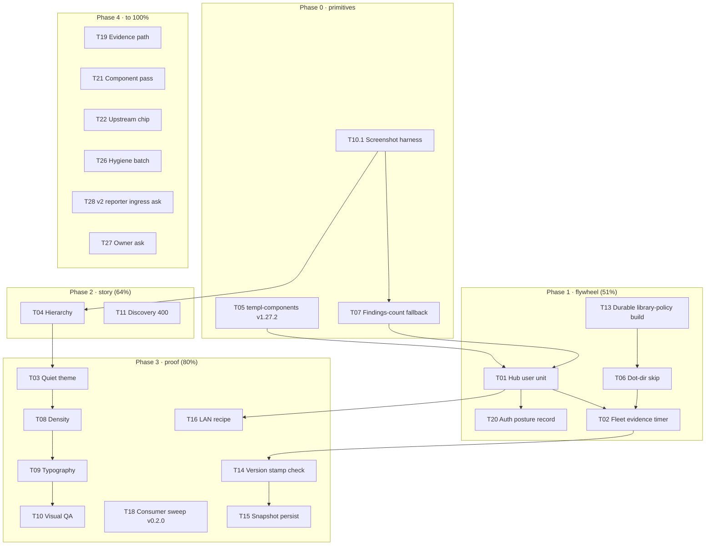

# Fleet Governance 80/20 Execution Plan, rev 2 (library-policy and go-compliance)

**Created:** 2026-11-24 23:15 CET · Crush (glm-5.4) · supersedes
[rev 1](2026-11-24_22-36_fleet-governance-80-20-execution-plan.md) after a
code-level review of every rev-1 claim · backlog basis: `TODO_LIST.md`,
`docs/status/2026-11-24_22-27_fleet-lan-serve-and-dashboard-ui-audit.md`,
`docs/status/2026-11-24_21-34_full-readiness-status-a-to-g.md`.
Format: `.md` + mermaid per the standing owner instruction recorded in rev 1.

## What changed against rev 1, and why

Every row below was checked against the repositories, the live evidence file
and the running hub on 2026-11-24 between 23:00 and 23:15 CET.

| Rev-1 item                                          | Verdict                                                                                                                                                                                     | Evidence                                                                                                             |
| --------------------------------------------------- | ------------------------------------------------------------------------------------------------------------------------------------------------------------------------------------------- | -------------------------------------------------------------------------------------------------------------------- |
| T17 push master + 14/14 CI                          | Already done                                                                                                                                                                                | 0 commits ahead of `origin` and `github`; CI run 45493394484 at `084f7ce` passed 14/14                               |
| T23 CVE literals                                    | Already done 2026-11-20                                                                                                                                                                     | library-policy `TODO_LIST.md:215-219`; `policies/security.go:14-16` routes every CVE through `mustCVE`               |
| T24 severity fork                                   | Already done 2026-11-20                                                                                                                                                                     | library-policy `TODO_LIST.md:160-170`; `enhanced/types.go:32-38` covers all 5 severities                             |
| T25 `WhenAnyPresent`                                | Already done 2026-11-20                                                                                                                                                                     | library-policy `TODO_LIST.md:90`, `192-199`                                                                          |
| T07 diagnosis ("producer verdict logic")            | Wrong lead. The "—" is the severity cell, empty for all 204 rows because the frozen v1 wire cannot carry severities. That is an owner decision, not a bug.                                  | `hub/internal/dashboard/rows.templ:28,84-87`; `v1.go:45-59`; `reporter.go:58-61`; `docs/decisions/v2-wire-design.md` |
| T02 value claim ("stale and fail-rate become real") | Overstated. The file store replaces a repo's row on every run (documented), so `runs` stays 1 and `fail_rate` stays 0 or 1. A timer delivers freshness and honest staleness, never history. | `filestore.go:111-140`; `reporter.go:183-201`; `adapter.go:67-95`                                                    |
| T01 unit shape                                      | Contradictory. The shipped reference unit (`DynamicUser`, `ProtectHome=true`) cannot read a file under `~`, and rev 1 named both `User=lars` and `systemctl --user`.                        | `deploy/compliance-hub.service:32-34,43`                                                                             |
| T12 discovery-file wiring                           | Cannot work. The hub has no such flag; never-covered derives from the discovery daemon's snapshot.                                                                                          | `hub/internal/cli/flags.go:22-23`; `hub/internal/cli/refresher.go:259-272`                                           |
| T10 ordering                                        | The screenshot harness was scheduled after the four tasks that need it (T03.5, T04.4, T08.3, T09.4)                                                                                         | rev 1 text                                                                                                           |
| "ALL backlog items covered"                         | False: the cmdguard follow-ups row was missing                                                                                                                                              | `TODO_LIST.md:40`                                                                                                    |
| Sizing                                              | Subtasks were uniform 8/10/12-minute placeholders; T18.x and T27.1 broke the plan's own 12-minute rule                                                                                      | arithmetic                                                                                                           |

## Decisions taken (recorded defaults, all reversible)

| #  | Decision                                                                                                                                                                                                           | Rationale                                                                                                                                                 |
| -- | ------------------------------------------------------------------------------------------------------------------------------------------------------------------------------------------------------------------ | --------------------------------------------------------------------------------------------------------------------------------------------------------- |
| D1 | The v1 wire stays frozen. This plan ships a findings-count fallback in the dashboard only; severities and run history for reporters ride the v2 design (`docs/decisions/v2-wire-design.md`), which is owner-gated. | `reporter.go:58-61` documents the severity drop as deliberate; the v2 sketch names it pain point 1                                                        |
| D2 | Hub deployment: a `systemctl --user` unit (linger is already enabled), `ExecStart` on a GC-rooted store path, `--source file` reading the XDG evidence file, bind `192.168.1.150:8477`.                            | The user-unit pattern is the house convention (`nextd-refresh`, `fleet-review`, `quotaboard`); a store path cannot drift with the auto-committed checkout |
| D3 | Binary supply for both services: `nix build --out-link` into `~/.local/state/<service>/current`. Never `/tmp`, never `nix run`, never a hand-built `go build`.                                                     | The rev-1 flywheel ran on a `/tmp` binary; a Nix build also stamps the producer version (T14)                                                             |
| D4 | Timer cadence: daily at 05:10, `Persistent=true`. The scan takes about 20 seconds for 204 repos.                                                                                                                   | Matches the rev-1 default; owner may change the calendar                                                                                                  |
| D5 | Design direction: quiet and disciplined, data first.                                                                                                                                                               | rev-1 default (report section g, question 1)                                                                                                              |
| D6 | Auth posture: write the threat sketch and a recommendation; the sign-off itself is an owner decision and goes out in the T27 ask.                                                                                  | `TODO_LIST.md:63` couples deployment with the g1 decision; an agent cannot sign off a risk acceptance                                                     |

## Pareto derivation

**Value model (operator-Lars):** V5 data trust, V4 always-on visibility, V3
glanceable credibility, V2 currency and hygiene, V1 polish.

**The 1% that delivers 51%: the loop runs, is seen, and shows findings.**
`T10.1` (screenshot harness, the verification primitive every later task
needs), `T01` (hub under systemd), `T13` + `T06` + `T02` (a durable producer
that records clean evidence daily), `T07` (a failing row shows its findings).

**The 4% that delivers 64%: trust and the two-second story.**
1% + `T05` (patch bump with the `</script>` guard), `T04` (hierarchy),
`T11` (discovery 400), `T20` (auth posture record).

**The 20% that delivers 80%: currency, repeatability, proof.**
4% + `T03`, `T08`, `T09`, `T10` (the visual pass, verified by pixels),
`T14`, `T16`, `T18`, `T15`.

**The rest:** `T19`, `T21`, `T22`, `T26`, `T28`, `T27`.

## Execution graph

## Level 1: tasks

Sizes are honest ranges, not minute arithmetic. `Depends on` lists tasks that
must land first.

| #     | Task                                                                                                                        | Repo                                    | Size       | Tier | Depends on    |
| ----- | --------------------------------------------------------------------------------------------------------------------------- | --------------------------------------- | ---------- | ---- | ------------- |
| T01   | Hub as a `systemctl --user` unit on a GC-rooted store path; replaces the session-bound server (PID 474068 at plan time)     | go-compliance, host                     | 1–1.5 h    | 1%   | T05, T07      |
| T02   | Daily fleet evidence timer (`Type=oneshot` + `.timer`) writing the XDG evidence file                                        | host                                    | 0.5–1 h    | 1%   | T01, T06, T13 |
| T06   | Fleet discovery skips dot-directories, with regression tests                                                                | library-policy                          | 0.5–0.75 h | 1%   | T13           |
| T07   | Findings cell shows the gate-findings count when no severity breakdown exists; never "—" on a failing row                   | go-compliance                           | 0.5–1 h    | 1%   | T10.1         |
| T10.1 | Screenshot harness (headless render, light and dark, narrow viewport)                                                       | go-compliance                           | 0.5–1 h    | 1%   | none          |
| T13   | Durable `library-policy` build via `nix build --out-link` (the SystemNix pin bump stays owner-gated)                        | library-policy, host                    | 0.5–1.5 h  | 1%   | none          |
| T04   | Hierarchy: the failing story lands in two seconds                                                                           | go-compliance                           | 1–1.5 h    | 4%   | T10.1         |
| T05   | templ-components v1.27.0 to v1.27.2 in the hub, CSS regen, tests                                                            | go-compliance                           | 0.5–1 h    | 4%   | none          |
| T11   | Discovery daemon `400 Bad Request` at serve start: root cause, fix or verified upstream issue                               | go-compliance, project-discovery-daemon | 0.5–2 h    | 4%   | none          |
| T20   | Auth posture: threat sketch for the LAN bind plus a recommendation in `bind-posture.md`; sign-off routed to T27             | go-compliance                           | 0.5–1 h    | 4%   | T01           |
| T03   | Quiet `@theme` re-skin: one accent, muted severity ramp, light and dark                                                     | go-compliance                           | 1–1.5 h    | 20%  | T04, T05      |
| T08   | Table density and severity coherence                                                                                        | go-compliance                           | 0.5–0.75 h | 20%  | T03           |
| T09   | Typography: `tabular-nums` and a weight scale                                                                               | go-compliance                           | 0.75–1 h   | 20%  | T03           |
| T10   | Visual QA over the finished dashboard (rest of T10)                                                                         | go-compliance                           | 0.5–1 h    | 20%  | T03, T08, T09 |
| T14   | Producer version stamp: verify the Nix-built binary reports a real version in evidence                                      | library-policy                          | 0.25 h     | 20%  | T02           |
| T15   | Fleet snapshot persisted to library-policy `docs/reports/`                                                                  | library-policy                          | 0.5 h      | 20%  | T02           |
| T16   | LAN serve recipe as a `bind-posture.md` appendix, cross-linked                                                              | go-compliance                           | 0.5–0.75 h | 20%  | T01           |
| T18   | Consumer sweep to core v0.2.0: library-policy, md-go-validator, BuildFlow                                                   | 3 repos                                 | 2–4 h      | 20%  | none          |
| T19   | Evidence path: XDG state file is the user-deployment default; docs aligned, no code change                                  | both                                    | 0.25 h     | rest | T02           |
| T21   | Component pass: `EmptyState` / `DataState` on empty views; `StatusBadge` versus local `StateBadge`                          | go-compliance                           | 1–1.5 h    | rest | T03           |
| T22   | DataStar signal-mode chip contributed to templ-components                                                                   | templ-components                        | 2–4 h      | rest | none          |
| T26   | Hygiene batch: CHANGELOG rows, `/tmp` probes, CSS drift check, M26 note, AGENTS re-check, flaky spec, libs index screenshot | go-compliance                           | 1.5–2.5 h  | rest | T10           |
| T28   | v2 reporter ingress: decision ask for the owner (history and severities for external reporters)                             | go-compliance                           | 0.25 h     | rest | none          |
| T27   | One consolidated owner ask                                                                                                  | go-compliance                           | 0.25 h     | rest | all           |

Removed from rev 1 with evidence in the errata table: T12 (cannot work),
T17, T23, T24, T25 (already done).

## Level 2: steps

| #     | Steps                                                                                                                                                                                                                                                      |
| ----- | ---------------------------------------------------------------------------------------------------------------------------------------------------------------------------------------------------------------------------------------------------------- |
| T10.1 | (1) headless render script for `/` in light, dark and a narrow viewport; (2) confirm the capture path works on this host before any visual task depends on it                                                                                              |
| T07   | (1) regression test: a failing row with gate findings must render a count; (2) `severityCells` falls back to the row's findings count; (3) regenerate templ, run the hub suite                                                                             |
| T05   | (1) bump the six templ-components modules in `hub/go.mod`; (2) regenerate UI artifacts; (3) rebuild the vendor hash through BuildFlow; (4) hub `-race` suite                                                                                               |
| T01   | (1) `nix build .#compliance-hub --out-link`; (2) write `~/.config/systemd/user/compliance-hub.service`; (3) daemon-reload, enable; (4) stop the session server, start the unit; (5) verify page and `/v1/compliance` on the LAN address; (6) journal check |
| T20   | (1) threat sketch (who can reach the LAN address, what the hub exposes, what it writes); (2) recommendation in `docs/decisions/bind-posture.md` marked as awaiting sign-off                                                                                |
| T13   | (1) identify the library-policy flake package output; (2) `nix build --out-link ~/.local/state/compliance-fleet/current`; (3) confirm `fleet --record` and the stamped version                                                                             |
| T06   | (1) skip dot-directories in `discoverFleetRepos`; (2) table-driven unit test; (3) BDD spec per repo conventions; (4) build, test, lint                                                                                                                     |
| T02   | (1) write `fleet-evidence.service` (oneshot, explicit evidence file); (2) write the `.timer`; (3) enable and trigger once; (4) verify evidence mtime and a live hub refresh; (5) journal check and ops note                                                |
| T04   | (1) hero line with the failing ratio computed server-side; (2) stale and never-covered become inline chips; (3) cards ordered worst first with accent only on failing; (4) regenerate CSS, before and after screenshots                                    |
| T11   | (1) capture the request the hub sends and the daemon's log; (2) read the daemon's API contract; (3) fix, or file a verified upstream issue                                                                                                                 |
| T03   | (1) read the templ-components consumer theming guide; (2) pick tokens; (3) `@theme` block in the consumer CSS; (4) regenerate; (5) screenshots in both modes                                                                                               |
| T08   | (1) library `Table` padding props on the fleet table; (2) severity column coherent with the ramp; (3) regenerate, screenshot                                                                                                                               |
| T09   | (1) system font stack with `tabular-nums`; (2) `@theme` font variables and a weight scale; (3) numeric cells opt in; (4) regenerate, screenshots                                                                                                           |
| T10   | (1) capture the finished dashboard; (2) fix what the captures show; (3) keep the harness as a repeatable script                                                                                                                                            |
| T14   | Run the timer once and read `buildflow_versions` in the evidence                                                                                                                                                                                           |
| T16   | (1) appendix in `docs/decisions/bind-posture.md`; (2) cross-links from the release runbook and AGENTS; (3) docs gates                                                                                                                                      |
| T18   | (1) library-policy bump plus vendor hash; (2) md-go-validator bump plus gates; (3) BuildFlow bump plus gates; (4) confirm the reporter contract is unchanged for each consumer                                                                             |
| T15   | (1) fresh record run; (2) normalized evidence into `docs/reports/`; (3) library-policy docs gates                                                                                                                                                          |
| T19   | Align AGENTS and the decision docs on the two defaults (system: `/var/lib/overview`, user: XDG state)                                                                                                                                                      |
| T21   | (1) `EmptyState` / `DataState` on the never-covered and stale views; (2) `StatusBadge` evaluation; (3) regenerate, tests                                                                                                                                   |
| T22   | (1) read the authoring guide; (2) design the signal-chip API; (3) implement with guard tests; (4) migrate the hub's `chips.templ`; (5) bump the hub pin                                                                                                    |
| T26   | (1) CHANGELOG rows; (2) remove `/tmp` probes with `trash`; (3) CSS drift check script; (4) M26 ROADMAP note; (5) AGENTS placement re-check; (6) flaky-spec hardening; (7) libs index screenshot; (8) docs gates and format check                           |
| T28   | Write the ask: v2 reporter-to-cache ingress is the designed home for history and severities                                                                                                                                                                |
| T27   | Consolidate every owner-gated item into one list in the execution report                                                                                                                                                                                   |

## Guardrails

1. No visual rewrites in Go beyond data and structure. Theming happens only
   via `@theme` overrides in the consumer CSS.
2. Gates stay green after every task: plain `buildflow` is the canonical gate,
   `docs-gates run .` plus `dprint check` for the corpus. Never overlap two
   full BuildFlow runs.
3. No sudo. User units need none; anything requiring a system rebuild goes
   into the T27 ask.
4. Never edit files without reading them. Expect "modified since read" races
   with the auto-commit daemon; re-read and retry.
5. No hub change ships without the running service verified afterwards (page
   and `/v1/compliance` on the LAN address).
6. library-policy work exports `GOEXPERIMENT=jsonv2,simd` for hand-run Go
   commands and respects the doc-sync pre-commit gate.
7. Every bug fix ships with a regression test.
8. The v1 wire contract is not modified (D1).

## Verification

- Hub page and API:
  `curl -fsS http://192.168.1.150:8477/v1/compliance | python3 -c "import json,sys; print(len(json.load(sys.stdin)['repos']))"`
  prints 204, and no row is named `.bf-jscpd-worktree` after T06 and T02.
- Hub suite: `cd hub && GOWORK=off go test -race -count=1 ./...` (sequential).
- Core suite: `GOWORK=off go test -race -count=1 ./...`.
- Canonical gate: `buildflow` in each touched repo.
- Corpus: `docs-gates run .` and `dprint check`.
- Deployment: `systemctl --user status compliance-hub.service fleet-evidence.timer`,
  `journalctl --user -u compliance-hub -n 20`.
- Producer: evidence mtime advances after the timer fires and the hub
  refreshes within a few seconds.

## Done-bar

Hub live under a user unit on the LAN address, timer enabled and observed
once with a live refresh, findings cell populated for every failing row, no
dot-directory row, dashboard verified by screenshots in both themes, hub on
templ-components v1.27.2, consumers on core v0.2.0, both repos' gates green,
living docs updated, and one consolidated owner ask in the execution report.
